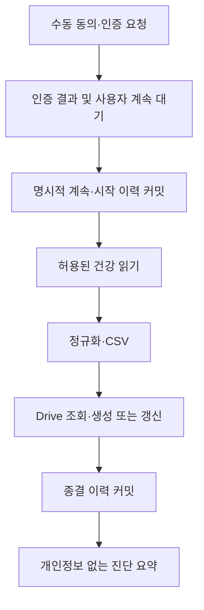

# 수동 동기화의 단계별 병목 측정

승인 근거: PR #9 독립 검토 결과를 보고한 뒤 사용자가 “응 그럼 계속해서 다음 단계 진행해”라고 지시했다(2026-11-02). 이 승인은 아래 측정 범위의 승인이다. 실행 계획은 별도 검토·승인 후 실행하고, 실제 최적화와 수치 목표는 포함하지 않는다.

## 1. 한눈에 보기

- 해결할 문제: 업로드가 느리다는 사용자 보고는 있으나 인증·사용자 대기, 건강 읽기, CSV 생성, Drive 조회·전송, 로컬 이력 저장 중 어느 단계가 지연되는지 측정되지 않았다.
- 바뀌는 결과: 개인정보를 담지 않는 단계별 진단과 반복 가능한 합성 기준선을 마련해 최적화할 구간을 근거로 선택한다.
- 완료 판단: 실행 단계와 요청 수를 분리한 재현 가능한 측정 보고서가 있고, 실제 기기 미측정과 합성 결과의 한계가 명확하며 기존 동기화 보장이 유지된다.

## 2. 범위

### 포함

- 인증/사용자 대기와 명시적 업로드 계속 이후 실행 시간을 분리한다.
- 로컬 시작·종결 이력 저장, Health Connect 읽기, 정규화·CSV, Drive의 앱 폴더/데이터 폴더/날짜 파일 조회 및 생성·갱신을 구분해 관찰한다.
- 요청 작업 종류별 횟수와 단조 시계 기반 경과 시간을 수집하는 최소 진단을 정의한다. 실제 건강 기록 건수·값·날짜·식별자는 진단에 포함하지 않는다.
- 동일한 합성 데이터·원격 트리 상태·환경에서 반복 실행하고 조건·표본 수·분포·오류/취소 결과를 보고한다.
- 실제 기기 측정이 가능하면 안전한 진단만 비공개로 확인하고, 공개 보고서에는 합성 증거와 비식별 결론만 남긴다.

### 제외

- 이번 측정 단계에서 캐시·병렬 업로드·HTTP 배치·자동 재시도 등 최적화 방식을 미리 선택하거나 구현하지 않는다.
- CSV·보고 날짜·읽기 범위/상한·권한·비공개 Drive 검증·동일 파일 갱신·취소·이력 내구성 계약을 바꾸지 않는다.
- WorkManager·SAF·백필·백엔드/MCP, 새 OAuth scope/서비스/의존성, 진단의 외부 자동 전송을 도입하지 않는다.
- 사용자 화면을 구현 상세의 대시보드로 바꾸거나 실제 건강 데이터/원시 trace를 공개하지 않는다.
- 임의의 초 단위 SLA·개선율·동시 요청 수를 확정하지 않는다. 개선 목표는 기준선 이후 별도로 정한다.

## 3. 확인한 사실과 가정

| 구분 | 내용 | 근거 또는 확인 방법 |
|---|---|---|
| 확인값 | 사용자는 느린 업로드의 병목 확인과 향후 속도 개선을 요청했다. 이번 후속 작업의 우선 제안은 측정이며, 변경 답변이 없어 이 순서로 초안을 준비했다. | 기존 `docs/backlog/sync-performance.md`, 현재 우선순위 질문 및 진행 안내 |
| 확인값 | V1 이력/복구 PR #8은 master `671d213cd8baf2c386436ae0bec2e0b905ef3da2`에 병합됐다. 실제 Galaxy/TalkBack/P0 수용은 여전히 별도 대기다. | PR #8, `docs/V1/review-followup.md` |
| 확인값 | coordinator는 파일을 차례로 upsert하고 uploader는 전체 파일 작업을 같은 mutex로 직렬화한다. 단순히 호출자를 병렬화해도 현재 공유 uploader 내부 작업은 직렬이다. | `SyncCoordinator.kt:38`, `PrivateDriveUploader.kt:26` |
| 확인값 | 기존 트리·파일/단일 페이지 합성 경로는 파일마다 앱 폴더·데이터 폴더·날짜 파일을 조회한 뒤 갱신한다. warm 단일 파일은 GET3+PATCH1이다. | `PrivateDriveUploader.kt:34`, 기존 요청 순서를 단언하는 테스트 |
| 확인값 | 새 master에서 기존 uploader 합성 회귀9개를 실제 재실행했고 실패·오류·skip0이다. 이는 실제 Google 지연 측정이 아니다. | `discovery.md`, `:core:test --tests com.ny.my.health.core.PrivateDriveUploaderTest` |
| 확인값 | 원래 UI 간격에는 인증과 사용자의 계속 대기가 포함될 수 있어 upload-only latency로 쓸 수 없다. | 기존 backlog의 측정 한계 |
| 추정값 | Drive metadata 왕복과 직렬화는 조사 후보이며 지배적인 실사용 병목이라고 확인되지는 않았다. | 구간별 시간·요청 수를 측정해 판단 |
| 위험값 | 실제 지연은 기기·네트워크·데이터량·기록 제공자·원격 트리 상태에 따라 달라진다. 합성 결과로 실제 사용자 개선을 단정하지 않는다. | 비교 조건과 측정 범위를 보고서에 기록 |
| 깨지는 조건 | 인증·저장 목적지·자동 실행 또는 읽기 범위가 바뀌면 이 측정 범위와 개인정보 경계를 재검토한다. | 관련 source/manifest/dependency diff |
| 확인값 | 전제 환경: Kotlin/JVM·JUnit·coroutines와 실제 local TLS transport 테스트, JDK21/SDK36 빌드 래퍼 및 API35 CI가 존재한다. | `android/{app,core}/build.gradle.kts`, 기존 테스트와 CI |
| 위험값 | 전제 환경: 단계별 runtime profiling observer/보고 형식은 없음, 도입 필요. 현재 세션에서 실제 Galaxy 필드 측정은 불가하다. | source 탐색, 후속 계획에서 계측 및 기기 수집 절차를 정함 |

## 4. 외부 계약과 흐름

외부 계약 변경: 해당 없음. 기존 CSV/Drive/Health Connect 계약을 그대로 따른다.

### 내부 흐름

비동기 인증과 명시적 실행 사이 대기를 구분하기 위한 관찰 경계다. 새 실행 경로나 자동 전송을 추가하는 흐름이 아니다.

## 5. 성공 기준

### 측정 의미

- 인증·사용자 대기와 실제 동기화 실행이 구분되어 대기 시간을 upload-only latency로 보고하지 않는다.
- 실행된 읽기·변환·Drive 작업·로컬 이력 저장의 경과 시간과 요청 작업별 횟수를 구분하고, 실행하지 않은 단계는 측정된0과 구분한다.
- 경과 시간은 벽시계 변경에 영향을 받지 않는 단조 시계로 측정하며 오류·취소 시 완료한 구간과 미완료 구간을 구분한다.
- 진단은 기존 SyncResult, 부분 업로드 수, 취소 전파, 권한/비공개 대상 판정 및 이력의 커밋·실패 보장을 바꾸거나 새 실행·재시도를 만들지 않는다.

### 개인정보와 자원

- 진단에는 건강 수치·건강 기록 건수·보고 날짜·CSV·계정/파일/레코드 식별자·토큰·URL/query·공급자 오류 원문을 포함하지 않는다.
- 공개 산출물은 고정 합성 fixture만 사용하고 실제 기기 진단은 명시적으로 공유한 안전한 결과 외에는 비공개로 유지한다.
- 계측 상태는 제한된 작업 종류의 요약으로 관리하며 페이지·기록마다 무제한 로그나 새 영속 사용자 이력을 만들지 않는다.

### 기준선과 후속 판단

- 동일한 fixture·원격 트리 상태·측정 환경의 반복 결과에 source revision, 조건, 표본 수와 산출 방법을 기록해 비교 가능한 기준선을 제공한다.
- 기존 요청 순서·동일 파일 갱신·권한/EMPTY·위험 대상 거부·취소 회귀가 유지되고, 측정 코드 때문에 추가 원격 요청이나 암묵 재시도가 생기지 않는다.
- 보고서는 실제 관찰과 코드상 후보·외삽을 구분하고, 실제 기기 증거 없이 사용자 체감 개선이나 실사용 지배 병목을 확정하지 않는다.
- 최적화 후보와 필요한 추가 검증을 측정 결과에서 도출하되 실제 최적화 구현과 수치 목표는 별도 승인 대상으로 남긴다.

## 6. 제약과 경계

- 지켜야 할 조건: 기존 개인정보·허용 권한·private Drive·파일 동일성·foreground 취소·로컬 이력 보장을 유지한다. 순수 계측 판정은 JVM에서 검증하고 실제 transport 경계는 기존 local TLS/필요한 통합 검증을 사용한다.
- 사용자 확인이 필요한 변경: 실행 계획의 승인, 기준선 이후의 성능 목표/최적화 방식, 새 의존성·인증·목적지·영속 진단·외부 telemetry 도입.
- 하지 않을 것: 측정 전 캐시/병렬화, 임의 SLA, 실제 건강 데이터의 공개, 기존 읽기 범위 축소나 검증·오류를 생략해 속도가 개선된 것처럼 보이는 변경.

## 7. 미해결 사항

- 측정 스펙은 승인됐다. 실행 계획은 별도 승인 대상으로 작성하며 제품 계측 코드는 아직 변경하지 않았다.
- 실제 Galaxy/네트워크 기준선을 수집할 때 사용할 조건과 수집 가능 시점.
- 지배 구간을 확인한 뒤 정할 성능 목표와 최적화 범위. 현재 임의 수치는 제안하지 않는다.
