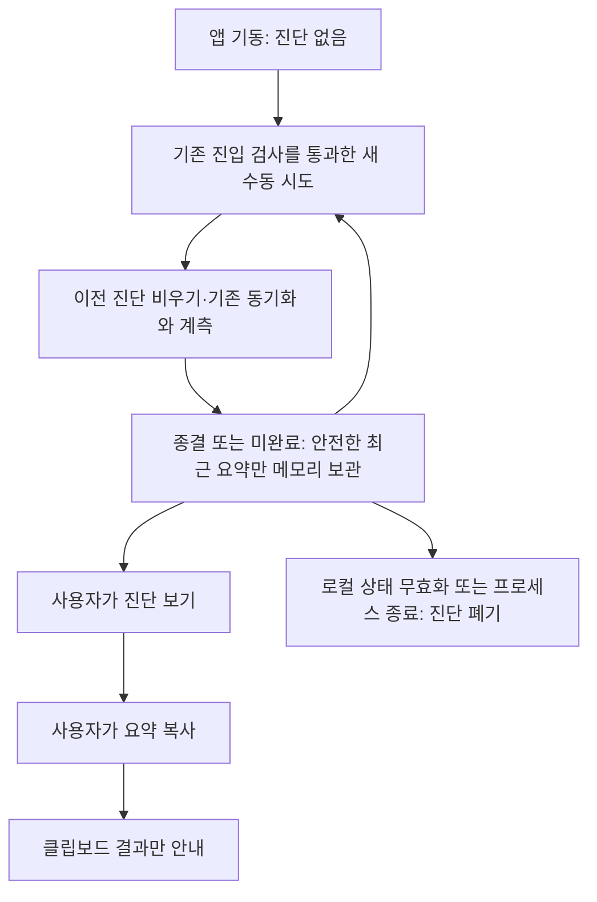

# PC 없이 수동 동기화 성능 진단 확인

승인 기록: 2026-11-03 소유자가 “승인할게. 그리고 pr은 한글로 작성해”로 이 스펙을 승인했다.

## 1. 한눈에 보기

- 해결할 문제: 사용자는 PC 연결이 어려워 현재 logcat 전용 성능 요약을 확인할 수 없으며 실제 기기의 지연 구간 분석이 진행되지 못한다.
- 바뀌는 결과: 디버그 앱 안에서 최근 수동 시도의 안전한 진단을 확인하고 명시적으로 복사해 PC 없이 전달할 수 있다.
- 완료 판단: 읽기 쉬운 단계별 시간과 안전한 복사 요약이 제공되고, 개인정보·상태 수명·복사 실패 및 기존 동기화 보장이 검증된다.

## 2. 범위

### 포함

- 기존 수동 동기화의 선택적 ‘성능 진단 보기’와 ‘요약 복사’를 디버그 앱에 제공한다. 기본 화면을 기술 대시보드로 바꾸지 않는다.
- 최근 시도에서 생성한 안전한 요약 1건만 현재 화면 모델의 메모리에 유지하고, 진단 없음·수집 중·종결·미완료를 구별한다.
- 인증/계속 대기, 실제 실행, 읽기, 정규화/CSV, Drive, 시작/종결 이력 시간을 의미에 맞게 표시한다. 작업/요청별 상세 통계는 기존 고정 형식으로 복사한다.
- 복사는 사용자가 버튼을 누를 때만 Android 클립보드에 수행하며 외부 앱 전송은 사용자가 별도로 결정한다. 표시·복사 오류는 동기화 결과와 분리한다. 복사된 텍스트의 OS 클립보드 수명은 앱의 메모리 수명과 별개이며 다른 클립보드 내용을 자동으로 지우지 않는다.
- 비공개 기기 수집 절차를 PC 없는 흐름으로 보완한다. 실제 Galaxy 수집 결과는 얻은 경우에만 기록한다.

### 제외

- 자동 업로드/telemetry, 원시 logcat 읽기, 로그·CSV·진단 파일 저장이나 Drive 진단 업로드, 새 권한/scope/서비스/의존성.
- 실제 건강 값·건강 기록 건수·보고 날짜·절대 시각·계정/기기/Drive 파일/레코드 식별자·토큰·URL/query·원시 공급자 오류의 진단 포함.
- 병렬화·캐시·배치·자동 재시도 등 최적화, 임의 SLA나 개선율 확정.
- 상단 가림 등 전반적 레이아웃 정리. 이는 [별도 backlog](../backlog/layout-refinement.md)에서 유지한다. 이 기능 자체의 버튼과 진단 텍스트는 읽고 조작할 수 있어야 한다.
- 기존 P0/실기기/계정/TalkBack 미확인을 완료로 변경하거나 과거 implemented 스펙을 수정하는 일.

## 3. 확인한 사실과 가정

| 구분 | 내용 | 근거 또는 확인 방법 |
|---|---|---|
| 확인값 | 사용자는 PC 연결이 어렵다고 밝혔다. | 현재 사용자 답변 |
| 확인값 | 계측 구현은 master에 병합됐으나 요약 전달 경로는 debug logcat뿐이다. | PR #9; `ManualSyncProfiling.publish`, `SyncViewModel.finishProfiling` |
| 확인값 | 종결 시 현재 collector는 폐기되며 화면 상태에 진단 필드는 없다. | `SyncViewModel.kt`, `SyncUiState` |
| 확인값 | 기존 summary는 고정 stage 10행, operation 7행, request 7행 및 숫자 열로 제한된다. 중첩 시간은 합산할 수 없다. | `ManualSyncProfiling.safeSummary`, `SyncProfiling.kt`, 기존 기기 절차 |
| 확인값 | 선택적 보기/명시적 복사로 PC 없는 사용자의 진단 전달 문제를 해결하는 범위를 승인받았다. | 2026-11-03 소유자 스펙 승인 |
| 확인값 | 디버그 한정·최근 1건 메모리 보관 범위를 승인받았으며 영속 진단이나 공유 파일은 범위 밖이다. | 2026-11-03 소유자 스펙 승인 |
| 위험값 | 클립보드는 OS 정책과 다른 앱의 영향을 받으며 복사 실패·미리보기가 가능하다. 앱은 외부 앱의 접근이나 사용자 전송 완료를 보장하지 않는다. | 플랫폼 경계와 실제 기기 확인; 구현 계획에서 사용 API 확인 |
| 깨지는 조건 | release 노출, 원시 로그 수집, 영속 진단, 외부 자동 전송 또는 새 권한이 필요해지면 범위를 재검토한다. | 관련 source/manifest/dependency diff |
| 확인값 | 전제 환경: Kotlin/JVM·JUnit·Compose UI 및 API35 instrumentation CI가 있고 safe summary/취소/이력 테스트를 재사용할 수 있다. | `android/{core,app}/build.gradle.kts`, `ManualSyncProfilingTest.kt`, `HistorySessionTest.kt`, `.github/workflows/android-emulator-tests.yml` |
| 위험값 | 전제 환경: 앱 내 진단 보관/보기/클립보드 경계와 테스트는 없음, 도입 필요. 현재 환경에서 사용자의 Galaxy 수집은 직접 실행할 수 없다. | 현행 UI/VM source와 사용자 PC 제약; 계획에서 기반 도입 분리 |

## 4. 외부 계약과 흐름

외부 API·CSV·Drive 계약 변경: 해당 없음. 명시적 복사 시 기존 Android 클립보드 서비스를 이용하며 새 외부 전송 프로토콜은 만들지 않는다.

### 내부 흐름

## 5. 성공 기준

### PC 없는 확인과 복사

- 디버그 앱에서 수동 시도 뒤 PC·ADB 없이 진단 보기를 열 수 있고, 진단이 없거나 아직 수집 중이면 과거 성공 또는 측정된 0으로 표시하지 않는다.
- 표시 시간은 인증/계속 대기와 실행을 분리하고 중첩 구간을 합산하지 않으며, 미관측·진행 중·종결된 실제 0과 표시 단위 때문에 작게 보이는 비영(非零) 시간을 구별한다.
- 사용자의 명시적 복사 동작만 기존 고정 24행 safe summary를 클립보드에 쓰고, 표시/복사 자체는 권한 요청·건강 읽기·업로드·자동 재시도·외부 전송을 시작하지 않는다.
- 복사 성공/실패는 별도 안내하고 실패해도 SyncResult·부분 확인 수·이력·원래 취소 전파와 이후 수동 동기화 가능 여부를 바꾸지 않는다.

### 개인정보와 수명

- 진단 표시와 복사에는 고정 단계/작업 라벨과 안전한 통계만 사용하고, 제외 범위의 건강 값·날짜/시각·개인 식별자·자격 정보·공급자 원문을 입력하거나 포함하지 않는다.
- 진단은 최근 시도 1건의 제한된 불변 요약으로만 메모리에 보관하고 디스크·저장된 상태·복원 번들·이력 DB·공유 파일에 기록하지 않는다.
- 유효한 새 시도 또는 로컬 상태 무효화 시 이전 요약을 지우고, 늦은 이전 콜백이 이를 다시 표시하거나 새 시도의 진단을 덮지 않는다.
- 화면 재생성 시 같은 화면 모델이 유지되면 진단을 유지할 수 있지만 새 화면 모델·새 프로세스에서는 진단 없음으로 시작하며, release 앱에는 진단 보기·복사 경로를 노출하지 않는다.

### 기존 보장과 증거

- 진단 경로를 추가해도 기존 동의·권한·명시적 계속·private Drive·동일 파일 갱신·순차 요청·취소·이력 커밋 및 삭제 계약을 유지한다.
- 합성 JVM/Compose 검증으로 정상·실패·취소·빈 진단·새 시도·무효화·지연 콜백·복사 실패·비디버그 조건을 확인하고, 실제 기기에서 수행하지 않은 수집이나 클립보드 동작은 미확인으로 남긴다.
- 사용자에게 공유 전 안전한 요약만 확인하도록 안내하고 클립보드/프로세스 수명 한계를 명시하며, 원시 로그·건강 화면 첨부나 진단의 자동 외부 전송을 요구하지 않는다.

## 6. 제약과 경계

- 지켜야 할 조건: 기존 pure collector/안전 형식을 재사용한다. 결정·수명 로직은 JVM에서, 표시와 명시적 복사 상호작용은 기존 Compose/Android 테스트 기반에서 검증한다. 클립보드 플랫폼 경계를 실제로 확인하지 않은 mock 테스트로 OS 동작까지 입증했다고 주장하지 않는다.
- 사용자 확인이 필요한 변경: 이 새 스펙과 후속 실행 계획의 승인, release 노출, 영속/파일 진단, 자동 전송, 새 권한·의존성·인증·목적지 또는 최적화 범위.
- 하지 않을 것: 상단 가림 수정 선행, 실제 건강 자료 공개, 과거 스펙의 제외 범위를 소급해 승인된 것처럼 변경, 실기기/성능 결과 추정.

## 7. 미해결 사항

- 스펙과 실행 계획은 소유자 승인을 받았고 구현 후 독립 스펙 적합성11개 기준을 통과했다. 전체 PR 품질 검토와 실제 기기 확인은 실행 보고 및 PR 코멘트에서 구분한다.
- 구현 후 Galaxy에서 실제 안전한 요약을 전달할 수 있는지와 반복 측정 조건. 기존 기기/계정 미확인은 유지한다.
