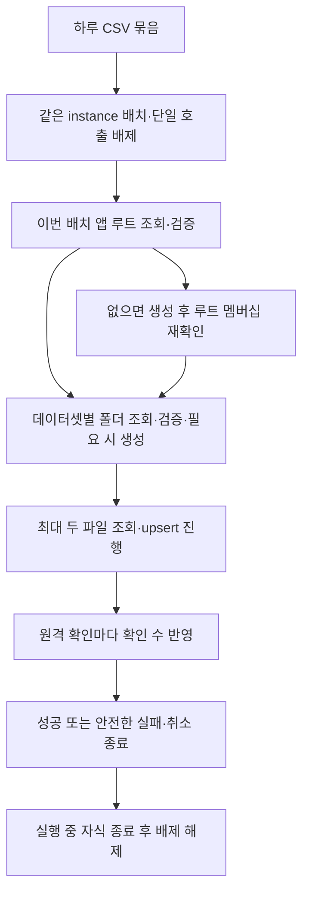

# 하루 CSV 배치의 비공개 Drive 왕복과 직렬 대기 개선

## 1. 한눈에 보기

- 해결할 문제: 성공한 실제 업데이트 한 차례에서 실행 시간 대부분이 Drive에 쓰였고, 하루 파일마다 같은 앱 루트를 다시 조회하며 파일 작업을 직렬로 기다린다.
- 바뀌는 결과: 하루 배치 안에서 앱 루트를 한 번 검증해 사용하고 파일 조회·저장의 제한된 병렬 실행으로 왕복과 대기를 줄이되, 비공개 대상 검증과 확인된 파일 수를 보존한다.
- 완료 판단: 기존 보안·실패·취소 회귀, warm 3CSV 요청 12→10과 동시 요청 최대 2, 동일 조건의 지연 포함 TLS 전후 분포 비교 및 독립 검토를 충족하고 실제 계정 검증의 한계를 명시한다.

## 2. 범위

### 포함

- 현재 수동 동기화가 내보낸 하루 CSV 묶음의 Drive 처리만 개선한다.
- 배치마다 앱 루트를 새로 검증하며 같은 배치에서만 결과를 재사용한다; 데이터셋 폴더별 metadata 검증은 유지한다.
- 파일 조회·upsert를 최대 두 작업까지 진행하며 같은 uploader instance의 다른 배치·단일 업로드와는 직렬 경계를 유지한다.
- 기존 단일 파일 upsert 호출과 단순 fake uploader의 순차 동작을 유지하며 coordinator의 부분 성공·실패·취소·프로파일링을 검증한다.
- 합성 지연을 준 local TLS 환경에서 기존 순차 처리와 개선 처리를 같은 조건으로 비교한다.

### 제외

- V1 전체 완료 선언, WorkManager·백필·SAF·새 인증 흐름·서버·새 권한·새 의존성.
- 영속 folder/file-ID cache, CSV 또는 건강 데이터의 신규 영속 저장, 무제한 병렬화, 자동 재시도.
- CSV·Health Connect 읽기 범위·정규화·수동 동의 및 별도 업로드 계속 행동의 변경.
- 실제 계정·Galaxy·TalkBack·기존 P0 미확인 항목을 합성 테스트로 통과 처리하는 것.

## 3. 확인한 사실과 가정

| 구분 | 내용 | 근거 또는 확인 방법 |
|---|---|---|
| 확인값 | 사용자는 병목 개선부터 V1까지 진행하고 스펙·계획·구현·PR 병합 판단을 자동 승인하도록 위임했다; 별도 세션의 독립 PR 검토와 한국어 댓글 의무는 유지한다. | 2026-11-05 세션의 소유자 지시; `AGENTS.md` 독립 PR 검토 규칙; 이 스펙의 approved는 이 위임에 근거하며 검토 성공 자체를 승인 근거로 삼지 않는다. |
| 확인값 | 기준 소스는 `feat/v1-drive-optimization`의 `20baaa4`이며 coordinator는 파일마다 upsert하고 uploader는 전체 단일 파일 작업을 mutex로 직렬화한다. | `android/core/src/main/kotlin/com/ny/my/health/core/{SyncCoordinator,PrivateDriveUploader,Ports}.kt` 직접 확인. |
| 확인값 | 사용자가 제공한 안전한 집계에서 업데이트 3건 성공 시 EXECUTION 10.463710725초, DRIVE_TOTAL 9.747520986초였고 앱 폴더 조회 3회/1.729558540초, 데이터셋 조회 3회/1.245373905초, 파일 조회 3회/1.192369427초, 업데이트 3회/5.576854791초였다. | 세션의 비식별 집계 요약만 사용; 원본 덤프·본문·계정/파일 식별자는 저장하지 않는다. 중첩된 operation과 request 시간은 중복 합산하지 않는다. |
| 확인값 | 앞선 생성 3건 사례도 실행 약 10.72초, Drive 약 9.89초였다; 두 사례는 각각 n=1이어서 실제 p50/p95 또는 개선율의 근거가 아니다. | 소유자가 전달한 집계 요약; 업데이트와 생성을 같은 분포로 묶지 않는다. |
| 확인값 | 현재 단일 페이지 warm 1CSV는 4회, cold 1CSV는 7회, warm 3CSV는 12회 요청이며 기존 local TLS 테스트는 시나리오별 예열 3회와 측정 10회, nearest-rank p50/p95를 기록한다. | `PrivateDriveUploaderTest.kt`, `SyncProfilingBaselineTest.kt`; 후자는 원격 실서버 지연을 주입하지 않는 기준선이다. |
| 확인값 | 변경 전 baseline test를 현재 세션에서 재실행해 통과했으며 warm 3CSV 12회 기준 증거가 로컬에 보존돼 있다. | 실행 담당자의 `/workspace/tooling/v1-drive-before-baseline-results`; 이 과거 무지연 기준선은 새 지연 비교와 직접 혼합하지 않는다. |
| 확인값 | 대상 검증은 소유자·비공유·미삭제·My Drive·app marker·정확한 부모·이름·MIME·ID를 확인하고 중복/불완전 조회·잘못된 pagination을 거부하며 새 앱 루트는 생성 후 재조회한다. | `PrivateDriveUploader.kt`의 appFolder/find/validate; `GoogleDriveTransport.kt`는 HTTPS endpoint allowlist·타임아웃·리다이렉트 및 자동 재시도 금지·취소를 구현한다. |
| 추정값 | 반복 루트 조회 제거와 파일 대기 겹치기가 합성 지연 환경에서 유효할 것으로 예상한다; 실제 환경의 초 단위 목표나 개선율은 확정하지 않는다. | 동일 조건 serial/optimized 반복 비교로 판단하고 실제 계정 결과와 구분한다. |
| 위험값 | 다른 uploader instance/다른 기기의 동시 생성 및 검증 직후 공유 변경 경쟁은 기존 한계이며 이 변경으로 원격 트랜잭션이나 전역 배제를 보장할 수 없다. | 제한을 검토 보고서에 남기고 같은 instance 경계만 시험한다. |
| 깨지는 조건 | 신규 권한·인증·목적지·영속 데이터·CSV 계약 또는 자동 실행이 필요해지면 이 한정된 스펙만으로 실행하지 않는다. | 관련 manifest/dependency/API/저장소 diff 검토. |
| 확인값 | 전제 환경: JDK21, `/workspace/tooling/android-sdk/platforms/android-36`, Gradle wrapper, JUnit/coroutines, MockWebServer·okhttp-tls 및 기존 실제-client TLS harness가 존재한다. | 로컬 파일/`java -version`, `android/{app,core}/build.gradle.kts`, `SyncProfilingBaselineTest.kt`. |
| 확인값 | 전제 환경: 계정 없는 API35/36 instrumentation CI가 존재하며 google_apis 이미지를 사용한다; Play Store 로그인 가능 여부를 보장하지 않는다. | `.github/workflows/android-emulator-tests.yml`. |
| 위험값 | 전제 환경: 로컬 emulator와 `/dev/kvm` 없음; 실제 Drive 계정 credential 없음. 실제 계정 검증은 미확인이며 CI가 이를 대체하지 않는다. | 로컬 실행 파일·장치 확인 및 현재 세션 접근 범위; 도입/소유자 계정 검증 필요 시 별도로 기록한다. |

## 4. 외부 계약과 흐름

외부 계약 변경: 해당 없음. 기존 Drive REST endpoint·OAuth scope·CSV 계약을 유지하며 요청 수와 내부 실행 순서만 바꾼다.

### 내부 흐름

비동기 파일 작업과 배치 간 배제 경계가 정확성에 영향을 준다. 아래는 관찰할 흐름이며 인터페이스 이름·구현 방식은 고정하지 않는다; 데이터셋 준비를 먼저 직렬로 마치는 방식처럼 더 단순한 설계를 우선한다.

## 5. 성공 기준

### 왕복 감소와 제한된 병렬 처리

- 단일 페이지의 기존 private tree에서 서로 다른 데이터셋 3CSV를 업데이트하면 앱 루트 조회 1회·데이터셋 조회 3회·파일 조회 3회·업데이트 3회로 총 10회 요청하며, 기존 순차 기준 12회와 비교할 수 있다.
- warm 단일 CSV는 총 4회, cold 단일 CSV는 새 루트 생성 후 재확인을 포함해 총 7회 요청으로 기존 보호 절차를 유지한다.
- 지연이 있는 서로 다른 파일 작업은 실제로 겹쳐 실행되고 동일 instance의 배치 내 활성 Drive 요청은 언제나 2개 이하이다.
- 같은 uploader instance의 배치와 다른 배치 또는 단일 upsert가 겹치지 않으며 cold 동시 진입에서도 그 instance 때문에 앱·동일 데이터셋 폴더가 중복 생성되지 않는다.
- 다음 배치는 루트를 다시 조회하므로 앞선 배치 후 공유·이동·삭제·중복 등 안전하지 않은 변경을 감지하고 해당 대상 쓰기를 거부한다.

### 기존 호출과 확인 결과

- 기존 단일 upsert 호출자는 API 변경 없이 동작하고 배치 최적화를 제공하지 않는 기존 fake uploader는 파일을 원래 순서로 하나씩 처리한다.
- 하루 묶음의 모든 파일이 검증된 원격 확인을 반환한 경우에만 SUCCESS와 전체 확인 수를 반환하며 빈 응답 ID나 검증 실패는 성공으로 세지 않는다.
- 한 파일이 실패하면 새로운 파일 작업을 더 시작하지 않고 이미 시작한 작업의 종료를 정리한 뒤 실제로 확인된 파일만 uploadedFiles에 반영하여 FAILED를 반환한다.
- 실패 시 이미 전송된 원격 쓰기를 롤백했다고 주장하지 않고, 확인되지 않은 in-flight 쓰기는 성공 수에 넣지 않으며 안전한 Drive operation/kind/HTTP 분류를 유지한다.
- 취소는 CancellationException으로 전파되고 새로운 작업 시작과 실행 중 transport를 취소하며 모든 자식 작업을 종료한 뒤 같은 instance의 다음 호출을 허용하고, 종료 후 늦은 확인 콜백이 결과나 다음 시도의 확인 수를 바꾸지 않는다.

### 비공개 경계와 프로파일링

- 루트·데이터셋·날짜 파일의 소유권·비공유·My Drive·marker·정확한 부모·이름·MIME·ID 검증과 새 루트 멤버십 재확인을 유지하고 불완전 조회·페이지 간 중복·잘못된 pagination을 fail closed로 처리한다.
- HTTP 오류·네트워크 실패·취소·비정상 응답에서 자동 POST/PATCH 재전송을 추가하지 않고 토큰·CSV·건강값·원격 ID·공급자 본문 및 예외 원인을 로그·공개 보고에 노출하지 않는다.
- 겹친 요청의 성공·실패·취소 수가 실제 관찰과 일치하고 종료 후 모든 profiling active가 false이며 DRIVE_TOTAL 경과 시간과 누적 operation/request 시간을 구분한다.
- EMPTY·무권한·부분 허용·기존 CSV 내용·하루 날짜·수동 동의·별도 계속·로컬 이력 회귀가 기존 의미를 유지한다.

### 비교 검증과 증거 한계

- 동일 합성 CSV·동일 private tree·동일 주입 지연·동일 TLS transport/연결 예열 조건에서 serial/optimized를 각각 예열 3회 후 최소 10회 성공 측정하여 EXECUTION·DRIVE_TOTAL의 n·p50·p95·요청 수·최대 동시 요청 수를 기록한다.
- 비교용 serial 경로는 기존 단일 upsert의 순차 호출임을 명시하고 병렬 TLS 응답은 요청 경로·대상에 맞게 반환하여 전역 응답 큐의 우연한 순서에 의존하지 않는다.
- 지연 포함 warm 3CSV 비교에서 optimized의 EXECUTION·DRIVE_TOTAL p50과 p95가 serial보다 작고 오류 증가가 없으며, 측정 불안정 또는 역전 시 개선 완료로 판정하지 않고 원인을 보고한다.
- 실패·취소는 성공 분포와 분리하고 revision·harness·실행 환경·지연·표본 수·백분위 계산법을 기록하여 합성 개선을 재현할 수 있다.
- 실제 업데이트/생성의 n=1 관찰이나 local TLS 결과로 실제 사용자 p95·초 단위 SLA·개선율·계정 또는 기기 수용 통과를 주장하지 않고 미실행 항목을 명시한다.
- 별도 세션의 읽기 전용 검토자가 최신 head와 관련 전체 diff를 검토하고 한국어 PR 댓글에 검토 commit·범위·심각도·실제 검증·한계·병합 적합성을 남기며 차단 결함 수정 후 최신 head 재검토를 완료한다.

## 6. 제약과 경계

- 지켜야 할 조건: 기존 Kotlin/coroutines·분리된 core/transport 구조에서 가장 작은 변경을 선택하고 배치 안에서만 루트 결과를 재사용한다; persistent cache·추가 추상화는 도입하지 않는다.
- 지켜야 할 조건: 의미 있는 JVM 회귀와 실제 OkHttp local TLS의 지연·오류·취소 검증, `:core:test :app:testDebugUnitTest :app:assembleDebug :app:lintDebug` 및 기존 계정 없는 CI instrumentation 결과를 실행 증거와 함께 기록한다; 로컬 미지원 검증은 CI 또는 미확인으로 구분한다.
- 지켜야 할 조건: 합성 fixture만 사용하고 public 저장소에 사용자 원문 덤프·실제 건강 데이터·credential·개인 식별자·계정/파일 링크를 넣지 않는다; 기존 보안 검사를 약화하지 않는다.
- 사용자 확인이 필요한 변경: 위임 범위를 넘어서는 새 권한·인증 흐름·서비스·의존성·민감 데이터 저장 또는 외부 계약 변경; 현재 스펙 범위의 스펙/계획/개발 병합은 소유자 위임으로 승인한다.
- 하지 않을 것: 실제 계정이 없는데 계정 검증을 완료했다고 쓰거나 개발 병합으로 V1 출시·P0/Galaxy 수용을 완료 처리하지 않는다; 수동 업로드에 새 자동 재시도를 추가하지 않는다.

## 7. 미해결 사항

- 실제 계정과 Galaxy의 변경 후 latency·privacy·같은 ID 업데이트 확인은 현재 접근 수단이 없어 미확인이다; 합성 검증 및 개발 병합과 별개로 남긴다.
- 실제 환경 SLA와 개선율 목표는 없음; 반복 필드 측정이 확보될 때 결정한다.
- 기존 P0/Galaxy/TalkBack 및 더 넓은 V1 일정·백필·인증·SAF 수용은 각 기존 문서의 실제 상태를 유지한다; 이 한정된 최적화 스펙은 그 승인을 대체하지 않는다.
