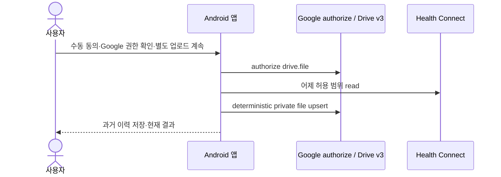
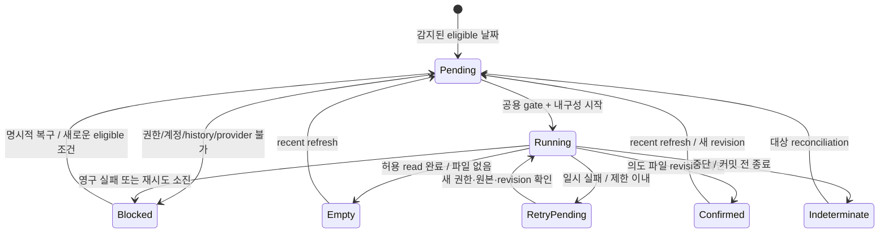

# V1 날짜별 복구·저장 목적지·자동 동기화 완성

승인 근거: 소유자는 현재 세션에서 **“병목 개선부터 V1 끝까지 자동승인으로 진행”**하도록 명시했다. 기존 V1 roadmap 안에서 필요한 스펙·계획·구현·독립 검토·수정·개발 병합 판단을 위임한 것으로 적용한다. 아래 bootstrap·batch·retry 정책은 그 범위 안에서 선택한 제한된 구현 정책이며 제품 SLA나 실기기 성능 수치가 아니다. 계정 로그인·시스템 권한·실기기 수용 결과·출시 승인을 대신하지 않는다. 구현된 과거 스펙은 수정하지 않는다. 이 문서는 새 에픽의 계약이며 실행 계획은 별도 세션에서 작성한다.

## 1. 한눈에 보기

- 해결할 문제: 수동 어제 내보내기와 과거 이력은 있지만 날짜별 누락·최신성·목적지별 결과를 추적하지 못하고 자동 실행과 SAF 저장 경로가 없다.
- 바뀌는 결과: 사용자가 정한 목적지와 동의 범위에서 최근 이틀을 갱신하고 누락 날짜를 제한된 묶음으로 복구하며, 별도로 켠 자동 동기화는 Android가 허용할 때 실행된다.
- 완료 판단: 5절의 날짜 계획·원자적 상태·동의/계정·실패 복구·저장·화면 기준을 자동 소프트웨어 검증과 독립 검토로 충족하고 실제 Galaxy·계정·TalkBack·provider 수용은 수행한 증거와 대기를 분리한다.

## 2. 범위

### 포함

- 기존 `docs/implementation-plan.md` V1와 `docs/V1/storage-destinations.md`의 날짜별 coverage, 최근 2일 refresh, bounded backfill, WorkManager, 사용자 선택 Drive API 또는 SAF local 목적지, 상태·재시도 요구를 완성한다.
- `MANUAL`/`SCHEDULED` trigger와 `DAILY_SNAPSHOT` strategy를 분리한다. 수동 전경 동작은 사용자가 시작하며, 자동 실행은 별도의 설명·목적지 구성·명시적 opt-in을 요구한다.
- V1 등록 시점을 기준으로 시작하는 제한된 날짜 범위, 앱 전용 내구성 상태, dataset/revision 확인, 중단·불명확 쓰기 복구와 전경/worker 중복 방지를 구현한다.
- Drive 계정을 명시적으로 고르고 그 계정으로만 권한 확인·업로드·coverage를 연결한다. SAF는 사용자 선택 local tree와 실제 capability probe 및 별도 privacy consent로 구성한다.
- 약 24시간 주기의 WorkManager `CoroutineWorker`, connected/battery-not-low 제약, 제한된 일시 실패 재시도와 영구 blocker를 제공한다.
- 기존 private Drive, v0.1 CSV, 권한별 필터, 이력 복구·삭제 계약을 보존하고 coverage·stale·pending·blocked와 접근성 흐름을 통합한다.
- 선행 성능 변경은 별도 `2026-11-05-drive-optimization` 업무의 승인된 스펙·실제 병합 결과를 통합한다. 이 에픽에서 새 SLA·병렬화·원시 계측을 추가하지 않는다.

### 제외

- V2 Changes API, V3 서버/MCP/원격 명령, V4 운동 계획, 새 backend·원격 credential 교환·refresh-token 저장.
- 최초 등록 전 임의 30일 또는 건강 이력 전체 backfill, 날짜 범위 임의 선택 UI, 기본 history 권한 확대, exact alarm·상시 서비스·polling.
- 동시 Drive+SAF both mode, 검증되지 않은 Google Drive 등 cloud document provider 지원 활성화, 자동 공개 공유·arbitrary 기존 Drive 폴더 선택.
- 인증 token·CSV 본문·raw 건강 기록의 내구성 저장, 개인 식별자나 측정값·CSV·URI·계정·원시 provider 예외의 공개 로그/테스트 증거 포함.
- 원격 파일 자동 삭제, 시스템 권한 자동 부여·철회, 기존 P0/실기기/계정/TalkBack/키 백업 미확인을 PASS로 바꾸거나 승인된 과거 구현 스펙을 고치는 일.

## 3. 확인한 사실과 가정

| 구분 | 내용 | 근거 또는 확인 방법 |
|---|---|---|
| 확인값 | 조사 baseline은 master `20baaa4`; 기존 수동 이력/UI·profiling·상단 layout 수정이 있고 일반 V1 날짜별/자동/SAF 구현은 없다. | `SyncViewModel`, `HistorySession`, `SqliteHistoryStore`, `HealthHomeScreen`, `PhoneProfilingSession`; app dependency와 manifest |
| 확인값 | `SyncCoordinator.sync(LocalDate)`는 날짜별 실행 가능하지만 파일 수만 반환하고 uploader는 `DriveUploader.upsert(CsvFile)`이다. | `core/SyncCoordinator.kt`, `Ports.kt`, `Model.kt` |
| 확인값 | 현재 token·동의·continuation은 메모리 전용이고 전경 이탈은 실행을 취소한다; 과거 history는 계정에 연결된 coverage가 아니다. | `SyncViewModel.pause/continueUpload`, `docs/V1/spec.md` |
| 확인값 | full V1는 누락 복구·최근 2일·약일일 WorkManager와 SAF 설계를 포함하며 both mode는 later이다. | `docs/implementation-plan.md:79-117`, `docs/V1/storage-destinations.md`, `docs/architecture.md` |
| 승인된 선택 | 등록은 한국 시간 어제부터, 한 batch는 최대 7개 고유 날짜, 최근 2일 우선 포함 후 오래된 누락으로 채운다; 일시 실패는 최초 실행 외 최대 3회 자동 재시도한다. | 소유자의 V1 자동승인 위임 안에서 수행량·권한·배터리를 제한하는 정책; 아래 계약이 원본 |
| 확인값 | HC 추가 background 권한/feature가 필요하고, 기본 역사 제한은 **최초 권한 부여 이전 30일**이다; 매 실행일 기준 rolling 30일이라는 보장은 없다. | 공식 [HealthPermission](https://developer.android.com/reference/androidx/health/connect/client/permission/HealthPermission), [read data](https://developer.android.com/health-and-fitness/health-connect/read-data); 2026-11-05 Context7 조회 |
| 확인값 | 설치 HC 1.1.0 source는 `FEATURE_READ_HEALTH_DATA_IN_BACKGROUND`, `FEATURE_READ_HEALTH_DATA_HISTORY`와 permission controller를 제공한다. 정확한 최초 권한 시각을 돌려주는 API는 조사한 `PermissionController`에 없다. | `/workspace/tooling/health-connect-source/sources.jar` 실제 읽기; 구현자는 다른 API를 추정해 호출하지 않는다 |
| 확인값 | 설치 auth 21.4.0에 `AuthorizationRequest.Builder.setAccount(Account)`, `Identity.getAuthorizationClient(Context)`, `AuthorizationResult.hasResolution/getAccessToken/getGrantedScopes`가 존재한다. | cache AAR `classes.jar`를 JDK21 `javap`로 조사; Gradle 실행 없음 |
| 확인값 | `AccountPicker.newChooseAccountIntent(AccountChooserOptions)` 및 account type 제한 API는 transitive `play-services-basement:18.5.0`에 존재한다. | 실제 AAR `javap`; 공식 [AccountPicker](https://developers.google.com/android/reference/com/google/android/gms/common/AccountPicker) |
| 확인값 | authorize는 기존 적격 계정·grant가 있으면 token을 반환할 수 있고 없으면 PendingIntent/오류를 반환한다; silent 성공 보장은 없다. | 공식 [AuthorizationClient.authorize](https://developers.google.com/android/reference/com/google/android/gms/auth/api/identity/AuthorizationClient), [authorization](https://developer.android.com/identity/authorization), 2026-11-05 Context7 조회 |
| 위험값 | 실제 Galaxy HC background feature, Google silent authorize, SAF local provider 지속 권한·짧은 overwrite·reboot·background 작동은 미검증이다. | 실기기/계정 전용 수용; 코드/에뮬레이터 성공으로 대체하지 않는다 |
| 확인값 | 전제 환경: core/app JVM JUnit·coroutines, local TLS, Compose/store 계측, host process recovery script, JDK21/SDK36 및 CI workflow가 존재한다. | `android/{core,app}/src/test`, `app/src/androidTest`, `android/ci/verify-history-process-recovery.sh`, `/workspace/tooling/{jdk-21.0.13+9,android-sdk}`, `.github/workflows/` |
| 위험값 | 전제 환경: WorkManager dependency·worker·test 기반은 없음, 도입 필요; SAF fake/test provider 기반은 없음, 도입 필요. | `android/app/build.gradle.kts`, source 파일 조사; 호환 버전·공식 release notes·dependency audit는 계획 단계에서 확인 |
| 위험값 | 전제 환경: 이 세션에서 제어 가능한 실제 Galaxy·계정·TalkBack·local DocumentsProvider 증거는 없음; 에뮬레이터 CI는 존재한다. | 기존 `docs/V1/device-acceptance.md`, storage 7 scenarios; 결과를 대기로 보존 |
| 깨지는 조건 | multi-process worker, token/CSV staging, both mode 또는 remote delete를 추가하면 이 에픽의 admission·privacy·revision 계약을 재검토해야 한다. | manifest/process/dependency 및 범위 diff 독립 검토 |

## 4. 외부 계약과 흐름

### 계약

- 계약 방식: 계약 우선.
- 계약 파일: 기존 [CSV v0.1](../data-contract.md)은 payload·path 계약 원본이며 변경하지 않는다. 이번 날짜/목적지/동의 상태 계약은 **아래 표와 정책**이 원본이다. 별도 서버 API·대외 스키마·계약 상대 담당자는 없다. Android/Google 공식 API 의미를 변경하는 계약이 아니다.

| 항목 | 제공 측 | 소비 측 | 내용 |
|---|---|---|---|
| 날짜 계획 | 앱 planner | 수동 실행/worker/UI | `Asia/Seoul` 등록일 이후부터 어제까지; 오늘·미래·등록 전 날짜 제외, 최대 7개 고유 날짜 |
| HC read | Health Connect | 앱 reader | 허용 category만, 실행마다 가용성/권한 재확인; background는 별도 feature/permission; 역사 제한·오류는 EMPTY로 숨기지 않음 |
| Google authorize | Play services | 앱 credential adapter | 사용자가 고른 `Account`를 `setAccount`로 고정하고 `drive.file`만 요청; token은 실행 메모리 전용; resolution 필요는 worker에서 BLOCKED |
| Drive files | Drive v3 | 앱 Drive destination | 기존 marked/private/owned My Drive 검증과 deterministic path 유지; remote confirmation 이후에만 확인 기록 |
| SAF tree | Android DocumentsProvider | 앱 SAF destination | 명시적 tree/privacy 동의, 실제 받은 persistable read/write grant, opaque URI; capability 검증된 local 구성만 활성화 |
| 로컬 상태 | 앱 private versioned store | planner/UI/execution admission | 날짜·destination generation·category coverage·dataset revision·확인/불명확 결과·고정 오류 종류; token/본문 금지 |

### 날짜 계획과 coverage 정책

처음 사용자가 V1 목적지를 명시적으로 구성하고 저장할 때 `enrollmentDay = yesterday(Asia/Seoul)`를 저장한다. 구 foundation history를 coverage로 승격하지 않는다. 시작은 어제 한 날짜이고 이후 날짜가 늘어난다. 임의 초기 30일 backfill은 없다. 계정/목적지 변경은 새 destination generation과 새 등록일을 생성하며, 이전 결과는 이전 목적지 이력으로만 남는다. 변경 전에 새 동의가 필요하고 이전 계정에 새 자동 work를 보내지 않는다.

매 trigger는 등록일부터 어제까지 미처리·실패·결과불명 날짜를 탐색한다. 어제/그제 중 등록일 이후 날짜를 우선 예약하고, 남은 slot을 가장 오래된 eligible 누락으로 채워 **합계 최대 7개 고유 날짜**를 만든 뒤 날짜 오름차순으로 실행한다. recent 날짜의 기존 확인은 refresh 후보에서 제외하지 않는다. 예를 들어 recent가 2개면 gap에 최대 5개 slot이다. 이 순서는 큰 누락 중에도 late-source refresh를 굶기지 않는 수행량 제한이다. 남은 누락은 내구성 pending이며 새 trigger에서 처리한다; 한 worker가 무제한 연속 batch를 돌지 않는다. unsupported/권한·history blocker 날짜는 pending을 보존하되 실행 가능한 다른 날짜를 계속 선택한다. 같은 고정 오류를 무한 재시도하지 않는다.

앱 시작은 로컬 상태·권한을 확인하고 누락을 표시한다. 자동 opt-in이 꺼졌다면 읽기/업로드/인증/실행용 enqueue는 하지 않는다. 켜졌다면 동일 planner를 사용하는 unique one-time catch-up enqueue를 허용하며 주기 work와 겹치지 않는다. 수동 실행은 사용자 설명·동의·새 권한 확인 후 같은 계획을 실행한다. 자동 opt-in은 수동 업로드 체크박스와 별개이고 초기값은 off이다.

추가 history 권한을 이 에픽에서 요청하지 않는다. 앱은 매 실행의 한국 시간 오늘에서 30일을 뺀 날짜를 **앱이 선택한 보수적 read floor**로 사용한다. 이는 시스템의 실제 최초 grant 이전 30일 제한보다 같거나 최근인 날짜 범위로 좁히는 정책이며 Android의 제한 자체가 rolling이라고 주장하는 것이 아니다. 최초 grant 시각을 얻을 수 있다고 가정하거나 추정 grant 시각 metadata를 저장하지 않는다. 필요한 날짜가 이 floor보다 이르거나 가용성/권한 판정이 불명확하면 `HISTORY_ACCESS_REQUIRED`와 명시적 미확인 gap으로 보존하고 읽어 EMPTY/완료로 만들지 않는다. 보수적 floor 때문에 장기 미접속 gap이 생겨도 지우거나 새 등록일로 조용히 리셋하지 않는다. history 확대 permission은 후속 별도 범위이다. 기존 interval overlap·page/sample 제한은 유지하고 권한 밖 interval의 전체 source completeness를 보장하지 않는다.

확인 상태는 destination generation/date/dataset/revision으로 분리한다. 허용 category와 읽기 완료 범위도 저장하여 일부 허용 범위를 5종 전체 완료로 표시하지 않는다. `EMPTY`는 허용된 read가 완료됐으나 내보낼 populated dataset이 없는 결과이며 upload confirmation/last upload success가 아니다. `checkedThroughDate`와 `uploadedThroughDate`를 구분하고 연속 범위의 빈 날을 설명한다. gap을 건너뛰어 가장 최신 성공 날짜만 covered-through로 사용하지 않는다. 권한 범위가 바뀌면 과거 제한 범위의 확인은 보존하되 새 범위가 이미 확인됐다고 간주하지 않는다.

revision은 생성 시각 하나의 차이로 달라지지 않게 dataset의 canonical semantic content와 schema/category 범위를 기준으로 식별한다. `generated_at`은 해당 revision의 최초 생성 시각으로 고정하여 같은 revision을 재생성할 수 있게 한다. 내구성 상태에는 hash/생성 시각/확인 metadata만 두고 CSV 본문은 저장하지 않는다. source를 다시 읽은 뒤 동일 revision일 때만 이전 확인을 재사용하고, 변경되면 새 revision으로 전환한다. pending 파일만 재시도할 때도 원본 재읽기와 revision 대조가 선행한다. 이전 populated dataset이 새 snapshot에서 사라진 경우 기존 remote 파일이 사라졌다고 주장하지 않는다: `REMOTE_STALE`를 표시하고 해당 새 revision의 full-current 판정을 막는다. 자동 삭제는 범위 밖이고 명시적 사용자 정리/새 목적지 후 재조정이 필요하다. source 삭제 전파를 완성했다고 주장하지 않는다.

### 동의·계정·실행과 복구 정책

Drive 구성은 전경 `AccountPicker`에서 `com.google` 계정을 고르는 동작, 선택 계정으로 제한한 `AuthorizationRequest`와 `drive.file` grant 확인, destination 및 자동 실행 privacy 설명으로 나눈다. 구성 식별에 필요한 account name/type만 app-private backup-excluded 상태에 보관하고 opaque destination generation으로 coverage를 묶는다. 식별자는 화면에서 사용자가 자기 선택을 확인하는 용도 외 로그·진단·공개 증거에 넣지 않는다. token·server auth code·refresh token은 저장하지 않고 offline-access/backend flow를 도입하지 않는다. 앱에 broad 계정 열거 권한을 추가하지 않는다.

worker는 application context로 `Identity.getAuthorizationClient(context).authorize(request.setAccount(boundAccount))`를 요청하며 이미 허용된 경우에만 access token을 쓴다. `hasResolution`, null/blank token, 누락 scope, 계정 없음/불일치 또는 영구 authorization 실패는 `ACCOUNT_AUTHORIZATION_BLOCKED`로 기록하고 전경의 명시적 복구를 안내한다. worker는 PendingIntent를 시작하거나 account picker/permission dialog를 띄우지 않는다. 계정이 사라지거나 선택을 바꾸면 다른 계정으로 fallback하지 않는다. 전경 resolution 결과도 현재 destination generation과 요청 ticket에 맞을 때만 수락한다. 실제 계정에서 silent 성공 가능 여부는 수용 증거가 필요하다.

SAF는 `ACTION_OPEN_DOCUMENT_TREE`에서 **실제로 받은** flags만 `takePersistableUriPermission`에 사용한다. local folder도 다른 앱/사용자가 볼 수 있음을 설명하고 사용자 privacy consent를 받는다. URI·document ID·grant mapping은 private 상태에만 보관한다. 앱 재시작/worker admission마다 persisted grant와 실제 접근을 확인한다. 전용 합성 파일로 enumerate/create/write/짧은 overwrite/readback/cleanup을 probe하고 실패는 지원으로 표시하지 않는다. probe는 실제 reboot·background 검증의 대체가 아니며 그 capability는 해당 검증이 끝날 때까지 disabled이다. 미검증 cloud provider는 선택되어도 활성 destination으로 저장하지 않는다. SAF 수동 local 사용과 자동 background 허용은 별도 capability이다.

대상 파일은 deterministic name으로 찾되 duplicate/ambiguous/moved/deleted 문서는 임의 대체나 suffix 생성으로 숨기지 않는다. `ACTION_CREATE_DOCUMENT`를 upsert로 쓰지 않는다. truncating mode·close·readback으로 정확한 bytes를 확인하고 shorter payload에 trailing bytes가 남지 않아야 한다. write 전에 pending journal을 커밋하고 재시작 시 기존 대상·소유 tree·내용을 조정한 뒤 재시도한다. 파일 간 원자성이나 provider stream 성공이 cloud durability/ChatGPT 가시성이라는 보장은 없다.

한 프로세스의 공용 execution gate와 private durable attempt journal을 사용한다. 전경/주기/one-time worker/중복 UI는 같은 gate로만 읽기·쓰기 진입하며, gate를 얻지 못한 요청은 pending으로 병합한다. journal의 미종결 실행은 새 프로세스 시작 시 결과불명으로 복구하고 파일 reconciliation 전 coverage를 전진시키지 않는다. 현재 SQLite의 path lock은 store 호출 보호일 뿐 전체 sync admission이 아니다. WorkManager 기본 같은 앱 프로세스만 지원하고 remote/multiprocess service나 `android:process` worker는 노출하지 않는다. OS가 이전 프로세스를 종료하면 in-memory gate는 사라지므로 durable journal로 중단을 복구한다; 실제 살아 있는 동일 프로세스 실행을 임의 lease timeout만으로 탈취하지 않는다.

설정 변경·자동 opt-out·로컬 설정 초기화는 generation을 먼저 무효화하고 queued work를 취소한다. 취소는 이미 전송한 remote 쓰기를 되돌린다는 뜻이 아니다. stale callback은 무효 generation의 결과를 새 coverage에 커밋하지 못한다. 기존 “로컬 이력 삭제”는 foundation history만 지우는 기존 계약을 유지한다; 동기화 설정/coverage 초기화는 별도 범위 안내·확인과 내구성 완료 판정이 필요하다. 설정이 지워지면 자동 off·fresh destination consent를 요구하며 원격 파일/외부 grant를 삭제·철회했다고 주장하지 않는다.

### 호출 흐름 (변경 전/후)

**변경 전**



**변경 후**

```mermaid
sequenceDiagram
    actor U as 사용자
    participant A as Android 앱 / WorkManager
    participant H as Health Connect
    participant G as Google authorize / Drive v3
    participant S as DocumentsProvider
    U->>A: 목적지·계정/폴더 동의; 자동 실행은 별도 opt-in
    Note over A: trigger → bounded planner → 공용 admission → durable pending
    alt Drive API
        A->>G: 선택 Account로 authorize drive.file
        Note over A,G: worker resolution 필요 시 blocked, UI 실행 없음
    end
    A->>H: 날짜별 허용 read (background feature/permission 확인)
    alt Drive API
        A->>G: private file upsert
    else 검증된 SAF local
        A->>S: grant probe / enumerate / truncating upsert / readback
    end
    Note over A: 확인된 파일만 commit; 실패/EMPTY/unknown 분리
    A-->>U: covered-through·gap·stale·다음 동작
```

### 내부 흐름



### 배포 순서

별도 배포 상대 없음. source 구현 순서는 [completion roadmap](completion-roadmap.md)을 따른다. foundation history는 파괴적으로 migration하지 않는다. 새 상태 포맷은 versioned admission 정책·명시적 reset을 갖추고 미지원/손상 읽기를 자동 empty로 덮지 않는다. 자동 기능은 설정이 없는 기존 설치에서 off로 시작한다.

## 5. 성공 기준

### 날짜와 의미

- 새 목적지 구성은 한국 시간 어제를 등록일로 저장하고 기존 foundation 이력을 coverage로 사용하지 않으며 등록 전·오늘·미래 날짜를 읽거나 enqueue하지 않는다.
- planner는 등록 이후 recent 두 날짜를 포함해 가장 오래된 eligible 누락으로 채운 최대 7개 고유 날짜를 오름차순으로 만들고 남은 gap·history blocker를 내구성 pending으로 유지한다.
- 앱 시작은 자동 opt-in이 없으면 감지·표시만 수행하고 자동 opt-in이 있으면 같은 planner의 unique catch-up을 enqueue하며 읽기/업로드를 UI 복원 부수효과로 직접 실행하지 않는다.
- EMPTY·제한된 category 확인·upload confirmation·연속 checked-through·uploaded-through를 구분하고 일부 허용 범위나 worker 실행 성공만으로 5종 전체 완료·현재성·gap 없는 coverage를 주장하지 않는다.
- 매 실행 한국 시간 오늘에서 30일을 뺀 보수적 HC read floor 이전 또는 가용성/권한이 불명확한 날짜를 HISTORY_ACCESS_REQUIRED와 미확인 gap으로 유지하고 추정 최초 grant 시각을 저장하거나 원본 제한·오류·page/sample 초과를 빈 데이터로 처리하지 않는다.

### 내구성과 복구

- destination generation/date/dataset/revision과 시도·시작·확인 시각을 원자적으로 저장하고 저장 실패·강제 종료 전후 재열기에서 확인되지 않은 파일/날짜의 성공을 만들지 않는다.
- canonical content가 같으면 generated_at 차이로 새 revision을 만들지 않고 원본 재읽기로 revision을 확인한 뒤에만 이전 확인을 재사용하며 달라진 snapshot은 새 revision으로 전환한다.
- 부분 실패·취소·결과불명 후 대상 reconciliation을 거쳐 pending 파일만 다시 처리하고 이미 확인된 동일 revision의 건강한 파일을 중복 create하거나 prior success를 지우지 않는다.
- 이전 populated dataset이 비게 되면 잔존 원격 파일을 REMOTE_STALE로 표시하여 새 revision의 full-current를 막고 원격 삭제·완료를 꾸며내지 않는다.
- 전경·주기·catch-up·중복 UI가 동시에 진입해도 공용 gate로 단일 실행만 시작하고 프로세스 손실 후 durable journal을 복구하며 설정 generation 변경 뒤 지연 결과가 새 coverage를 덮지 못한다.

### 자동 실행과 계정

- 자동 기능은 기본 off이고 전경에서 목적지·범위·지연 가능성 설명과 별도 opt-in 후에만 약 24시간 unique periodic CoroutineWorker를 connected/battery-not-low 제약으로 구성하며 exact-time·당일 완료를 보장하지 않는다.
- Drive 계정은 전경 AccountPicker로 명시적으로 선택하고 모든 authorization을 저장된 Account로 제한하며 계정 변경/제거 시 새 generation·동의를 요구하고 다른 계정으로 조용히 fallback하지 않는다.
- worker는 background HC feature/permission과 현재 category grant를 재확인하고 authorize resolution·누락 token/scope·계정 오류는 BLOCKED로 남기며 interactive UI를 시작하거나 token·auth code를 저장하지 않는다.
- 일시 네트워크/허용된 service 실패만 exponential backoff로 최초 실행 외 최대 3회 재시도하고 영구 실패·불명확 create는 맹목 재전송하지 않으며 retry 소진은 다음 명시적 trigger까지 visible pending/blocked로 남긴다.
- 자동 opt-out·설정 변경·reset은 queued work와 현재 generation의 admission을 무효화하고 이미 발행된 원격 쓰기를 취소로 rollback했다고 표시하지 않으며 기존 이력 삭제와 설정/coverage reset 범위를 각각 정확히 안내한다.

### 저장 목적지

- Drive destination은 기존 drive.file·marked private owned My Drive·ambiguous target 거부·deterministic same-file 갱신·확인 응답 계약과 CSV v0.1을 유지한다.
- SAF local 구성은 별도 privacy/tree 동의·실제 granted flags·persisted permission·합성 probe가 확인된 capability만 활성화하고 미검증 provider/background capability는 disabled 또는 BLOCKED로 유지한다.
- SAF 동일 날짜의 더 짧은 재내보내기는 같은 대상에 정확히 truncation/readback되고 duplicate·moved/deleted·grant 철회·write interruption은 suffix 재생성이나 false success 없이 reconciliation/명시적 복구로 연결된다.

### 화면·보안·증거

- home은 현재 목적지·등록 이후 gap·연속 확인 범위·마지막 업로드·recent freshness·queued/blocked 사유와 다음 허용 동작을 구분하고 stale/영구 실패가 과거 성공에 가려지지 않으며 EMPTY를 업로드 완료로 쓰지 않는다.
- light/dark·큰 글자·Compose semantics 검증에서 동의·계정/폴더 선택·자동 설정·수동 실행·재시도·reset 확인에 도달할 수 있고 실제 TalkBack·Galaxy 관찰은 별도 미확인으로 남긴다.
- app-private 상태/backup 제외와 로그/진단 allowlist를 검증하여 raw 건강 데이터·CSV·token·계정/기기/문서 식별자·URI·provider 본문을 공개 로그·fixture·CI artifact에 포함하지 않는다.
- 실제 store 재열기·손상/미지원 상태·실행 취소·동시 admission·local TLS·합성 provider·worker 제약/권한·UI 회귀와 APK/lint 검증을 수행하고 각 PR의 독립 최신 head 검토를 마친 개발 완료와 Galaxy/계정/provider/Doze/배터리/TalkBack 수용 대기를 별도로 보고한다.

## 6. 제약과 경계

- `AGENTS.md`의 private export·권한·배터리·개발 gate 및 별도 세션 PR review를 따른다. 검토/수정/재검토 결과와 최종 reviewed head를 PR에 한국어로 기록한다. 새 architecture/schema/auth 결정은 ADR로 기록하고 자동승인 위임 근거를 남긴다.
- core planner/revision/state/admission은 SDK-free meaningful tests로, Android store는 실제 DB/파일 재열기와 atomic failure 경계로 확인한다. 호출 횟수 mock만으로 durable 성공을 주장하지 않는다. SAF에는 합성 DocumentsProvider/failure injection 기반을 도입하되 실제 provider 호환성 증거로 대체하지 않는다.
- worker test 기반/WorkManager 버전은 도입 필요 상태다. 구현 전 공식 [WorkManager release notes](https://developer.android.com/jetpack/androidx/releases/work)와 minSdk28/compile36/Kotlin·coroutines 호환성을 확인하고 resolved dependency audit를 수행한다. 불필요한 최신 SDK/dependency 일괄 upgrade는 하지 않는다.
- WorkManager [unique work](https://developer.android.com/develop/background-work/background-tasks/persistent/how-to/manage-work), [persistent work](https://developer.android.com/develop/background-work/background-tasks/persistent/getting-started/define-work) 공식 의미를 따른다. retry cap은 WorkManager 반복 주기 전체를 영구 중단하라는 뜻이 아니라 한 batch revision의 transient retry budget이다; runAttemptCount만으로 세대/주기 간 budget을 혼동하지 않게 private state로 관리한다.
- HC 범위는 현재 schema/category/pagination/overlap 안전성을 보존한다. 자동 실행은 background 권한 feature가 없으면 비활성이고 수동은 계속 가능하다. history 확대가 필요해도 별도 승인 없는 추가 permission 요청으로 우회하지 않는다.
- SAF는 공식 [documents files](https://developer.android.com/training/data-storage/shared/documents-files), [ContentResolver](https://developer.android.com/reference/android/content/ContentResolver), [DocumentsContract.Document](https://developer.android.com/reference/android/provider/DocumentsContract.Document) 계약을 따르며 tree를 경로 문자열로 변환하지 않는다. Android restricted root 선택 불가를 app failure로 숨기지 않는다.
- 현재 단일 Android 앱 프로세스만 지원한다. 기존 history DB lock의 범위를 sync 전체 transaction으로 오해하거나 WorkManager unique name 하나로 manual/periodic 모든 중복이 해결됐다고 가정하지 않는다.
- 저장이 필요한 최소 account name/type·tree URI는 app-private/backup-excluded 구성 정보이며 raw 데이터나 credential이 아니다. 이 추가 저장은 위임된 V1의 안전한 목적지 연결에 필요한 것으로 승인 범위에 포함한다. 공개 문서에는 합성 식별자만 쓴다.
- 사용자의 실제 로그인·picker/system consent·provider capability 관찰·배터리 수치/실제 TalkBack 검증은 자동승인으로 대신하지 않는다. 테스트 환경이 없으면 정확한 기기 절차와 미확인을 기록한다. 개발 완료가 앱 출시 승인이나 모든 provider 지원 뜻이 되지 않는다.
- 기존 P0 acceptance 미확인과 recoverable key backup 불확실성은 보존하고 이미 소유자가 확인한 원본 비교를 다시 미확인으로 되돌리지 않는다. 이 에픽이 그것을 기다리지 않는다는 현재 지시는 그 테스트가 통과했다는 뜻이 아니다.

## 7. 미해결 사항

- 소유자 답변이 필요한 새 제품 범위 질문: 없음. 등록일·batch/retry 상한·both later·동의/계정 연결은 위 자동승인 범위의 명시된 정책으로 사용한다.
- WorkManager 실제 호환 버전/신규 test dependency와 resolved-coordinate audit는 계획 단계에서 확인해야 한다; 이 문서는 특정 미검증 버전을 확정하지 않는다.
- Google silent authorization·background HC·실제 SAF local folder/provider의 해당 기능·reboot/Doze·배터리·TalkBack은 account/device 수용 대기다. 지원 불가가 확인되면 해당 capability는 BLOCKED/unsupported로 유지하고 개발 완료와 구별한다.
- 원격 dataset 삭제/동시 both mode·multi-process 지원은 후속 범위다. 현재 REMOTE_STALE은 제한을 숨기지 않는 명시적 결과이며 V2 삭제 전파를 대신하지 않는다.
