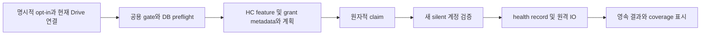

# Function-faithful V1 completion

## 1. 한눈에 보기

- 해결할 문제: 기존 수동 및 영속 상태 기반이 있지만 승인된 V1 자동 Drive 경로는 미완성이다.
- 바뀌는 결과: 사용자가 제한된 background Drive 동기화를 명시적으로 켜고 미완료·차단 범위를 확인한다.
- 완료 판단: 승인된 V1 계약과 아래 기준을 현재 head에서 검증하며 실기기·계정 수용은 별도 근거로 판정한다.

## 2. 범위

### 포함

- Complete the approved [V1 spec](../2026-11-05-v1-completion/spec.md) and [automation plan](../2026-11-05-v1-completion/automation-ui/plan.md); retain their detailed contracts and existing manual Drive and local SAF behavior.
- Durable retry ownership, summary reader/export, account-bound authorization, scheduler, shared execution gate, and status/settings.

### 제외

- 새 backend, refresh token 저장, Health Connect history 권한, exact alarm, cloud/background SAF, 동시 목적지와 허위 실기기 수용.
- 추가 CI 프레임워크, 추측성 성능 실험, 외관 정리와 승인 기능 밖 조사.

## 3. 확인한 사실과 가정

| 구분 | 내용 | 근거 또는 확인 방법 |
|---|---|---|
| 확인값 | At a70fee6 retry model and v2 schema/migration exist; future-schema fixtures and diagnostic scopes were corrected. | `SyncRetryBudget.kt`, `SyncRetryBudgetMigration.kt`, existing tests and CI scripts |
| 위험값 | Prior reported summary source is absent from this checkout; availability in other refs must be checked before reconstructing. | inspect refs and objects; preserve existing history |
| 확인값 | 전제 환경: Gradle wrapper, existing JVM/instrumentation tests, emulator full runner and WorkManager starter exist; actual emulator and account availability must be established per execution. | `android/gradlew`, `android/ci/run-emulator-validation.sh`, existing tests |
| 위험값 | Physical Galaxy, actual account/provider, TalkBack, P0 and private-backup acceptance remain unknown. | existing acceptance records; perform only authorized actual acceptance |
| 깨지는 조건 | A required external SDK capability or existing contract cannot be verified. | stop affected work and report evidence; do not infer support |

## 4. 외부 계약과 흐름

Existing Health Connect, Google Drive and Android contracts remain those in the approved V1 spec and `docs/data-contract.md`; no new external API is introduced. Background access requires supported feature, background grant and each relevant category grant. Drive 인증은 선택 계정에 고정된 새로운 silent 인증이며 proof는 health record 조회보다 앞선다. worker는 인증 UI를 실행하지 않는다. DB preflight 성공 후에만 HC feature/grant metadata로 계획하고 원자적으로 claim한 뒤 계정을 검증한다. off, due 이전, stale, 미해결 recovery에서는 외부 호출을 하지 않는다.

### 내부 흐름

## 5. 성공 기준

### 접근과 데이터

- 수동 Drive와 로컬 SAF의 기존 동의·권한·목적지·복구 동작을 유지하고 background 작업은 SAF를 사용하지 않는다.
- 자동 Drive는 명시적 opt-in 전까지 꺼져 있고 background 기능 지원과 background 및 각 category 권한을 요구한다.
- 지원 요약은 Health Connect Aggregate를 사용하고 체중은 최신 실제 기록이며 결측은 결측으로 둔다. 미입증 운동 심박은 BLOCKED로 표시하고 다른 허용 category는 독립 진행한다.

### 예약과 정확성

- 자동 작업은 connected 및 battery-not-low 제약의 24시간 unique WorkManager 일정과 최근 2일 refresh를 포함한 최대 7일 catch-up을 사용한다.
- 영속 retry lineage는 최초 실행 외 최대 3회 재시도하며 새 작업이나 원본 revision은 미완료 budget을 초기화하지 않는다.
- 수동 실행과 worker는 동일 canonical gate를 사용하며 worker는 health record 조회 전에 선택 계정의 새 silent 인증과 proof를 수행하고 UI를 띄우지 않는다.
- 영속 metadata는 재시작 후에도 확정 결과와 불확실한 create 및 취소 상태를 보존하며 blocked·stale·손상·미확인 상태를 완료로 표시하거나 자동 초기화하지 않는다.

### 표시와 검증

- 설정은 명시적 opt-in·끄기·reset과 함께 queued·blocked·coverage gap을 표시하고 끄기나 목적지 변경 시 이전 작업을 안전하게 무효화한다.
- 각 통합 PR 병합과 최종 1.0 전에 현재 head의 API 35·36 전체 Native와 기존 격리 host, JVM, lint 및 APK 빌드가 통과하며 테스트 삭제·skip·완화는 없다.
- 독립 적합성 검증과 새 세션 PR 리뷰 후 병합하며 수행하지 않은 실기기·계정·P0·접근성 수용은 pending으로 남긴다.
- APK 후보는 versionName 1.0.0 및 1보다 큰 versionCode를 사용하고 간결한 설치 안내와 미완료 수용 항목을 제공한다.

## 6. 제약과 경계

- 기존 T4/T5/T10 세부 계약과 T2/T3 hardening을 유지하며 ADR-012는 독립 적합성 통과 전까지 Proposed다.
- 소유자의 최신 우선순위는 기술 전달 계획의 개정 권한이며 건강정보·개인정보·보안·수용 gate를 약화하지 않는다.
- 영향받는 의미 있는 테스트와 실제 SQLite 대상 검증을 종속 통합 전에 수행하며 전체 Native gate는 작은 작업마다가 아니라 각 통합 head에서 수행한다.
- 공개 산출물에 개인정보·식별자·token·민감 provider 응답을 넣지 않으며 결측을 0으로 바꾸거나 정확한 실행 시각을 보장하지 않는다.

## 7. 미해결 사항

- 실제 기기·계정·TalkBack·private backup 및 P0 수용은 근거가 생길 때까지 미확인이다.
