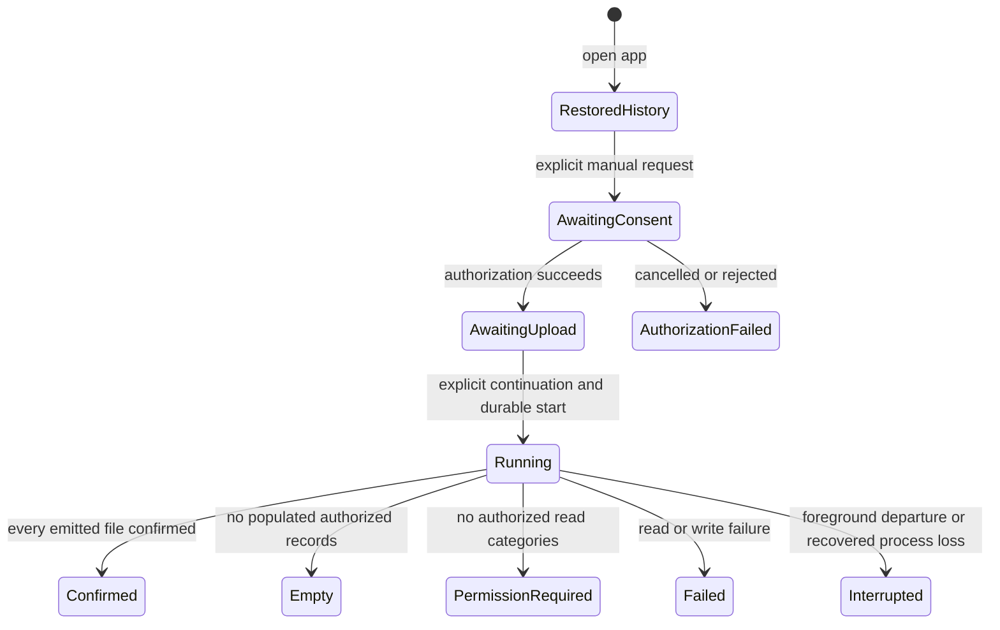

# V1 foundation — durable manual sync history

## 1. 한눈에 보기

- Problem: P0 loses attempt/success information on process death, so users cannot distinguish a previous confirmed upload from an interrupted attempt after reopening the app.
- Result: keep minimal app-private manual-sync history across process recreation while retaining fresh authorization, explicit upload continuation and foreground-only execution.
- Completion: persisted outcome and recovery behavior satisfy section 5 using synthetic automated tests and explicitly recorded Galaxy validation, without asserting current-account coverage from historical local metadata.

## 2. 범위

### 포함

- First V1 implementation slice: durable latest attempt and latest confirmed success, with reporting date, timing, authorized-category coverage, confirmed-file count and allowlisted outcome/failure category.
- Distinguish authorization attempt from actual execution start and completion; restore history as historical information on app open.
- Recover interrupted local execution metadata after process death and handle unavailable/corrupt local state explicitly.
- Preserve the existing manual yesterday-in-Asia/Seoul export and explicit local forget action; explain its local-only effect.
- Keep earlier success when a later attempt fails, is empty, loses permission or is interrupted; show limited authorized coverage without calling it a complete five-category day.

This is preparatory specification work. Implementation entry requires explicit P0 gate disposition and approval of this specification and its later execution plan. It does not declare P0 complete. The first slice is not completion of the full [V1 roadmap](../implementation-plan.md).

### 제외

- WorkManager, automatic reads/uploads on app open, background permission changes, missed-date backfill and date-range selection.
- SAF or both-destination implementation, arbitrary destination selection, per-file revision retry and account-bound durable destination coverage.
- Persistent OAuth tokens, persistent upload consent, account identifiers, raw measurements, exported CSV bodies or extra health-data staging.
- Changes to CSV schema, source aggregation, interval lookup, Drive scope/privacy checks, signing identity or implicit network retry.
- Performance instrumentation/optimization, incremental Changes API, backend, MCP and workout plans.

## 3. 확인한 사실과 가정

| Kind | Content | Evidence or confirmation |
| --- | --- | --- |
| Verified | Baseline is merged PR #6, `b9c4eb4`; application files remain identical to validated reader source `d33edae`. | Git diff and [current security disposition](../P0/current-security-disposition.md). |
| Verified | `SyncUiState` and token live only in ViewModel memory; `lastAttempt` currently starts before Google authorization completes. | `android/app/src/main/java/com/ny/my/health/SyncViewModel.kt`. |
| Verified | The coordinator exposes date-based execution and confirmed-file count, returning SUCCESS, EMPTY, PERMISSION_REQUIRED or FAILED; cancellation propagates. | `android/core/src/main/kotlin/com/ny/my/health/core/SyncCoordinator.kt` and `Model.kt`. |
| Verified | App-private backup and cleartext are disabled; no existing durable sync-history store or automatic scheduler is present. | App manifest and app/core sources. |
| Proposed scope | Durable manual history is the first slice of V1; scheduling, backfill and SAF follow separately. | Existing roadmap requires durable status; owner approval of this draft confirms slice order. |
| Risk | History cannot establish which Google account currently owns a remote export or whether every source record existed. | Do not persist account identities in this slice or use history to skip writes; UI must state its limited historical meaning. |
| Breaking condition | Adding automatic execution, durable consent/tokens, account-bound coverage or another destination invalidates this slice's consent/identity assumptions. | Requires a separate approved specification before implementation. |
| Verified | Prerequisite environment: JUnit 4/core coroutine tests, app local-TLS JVM tests, Compose instrumentation tests and SDK 36/JDK 21 tooling exist. | Existing test sources, Gradle files, `/workspace/tooling/run-health-command.py`. |
| Risk | Prerequisite environment: physical Galaxy/control is absent here; local emulator executable is absent, but an emulator CI workflow exists. | `/workspace/tooling/android-sdk/platform-tools/adb` exists; `.github/workflows/android-emulator-tests.yml`; device results remain owner-operated. |
| Risk | Prerequisite environment: durable Android store and restart/failure tests for it are absent, introduction required. | No store dependency/implementation in app; select the smallest suitable mechanism during the approved plan, without assuming Room/DataStore exists. |

## 4. 외부 계약과 흐름

External contract changes: none. [CSV v0.1](../data-contract.md), Health Connect read permissions, `drive.file`, existing private-target rules and explicit Google authorization remain unchanged. This slice defines local metadata behavior only and does not introduce a server API.

### 내부 흐름

Asynchronous execution and durable state introduce a recovery boundary. The diagram describes outcomes, not a new public API or a mandated storage technology.

Restoration performs no health read or remote write. Only an actually started execution can become an interrupted execution; an unfinished authorization request cannot be reported as a started upload. Durable history and consent are separate: restoring history never restores upload permission. A previous success is retained independently of the latest attempt outcome.

## 5. 성공 기준

### Durable history

- After confirmed manual upload and process recreation, the UI restores its reporting date, confirmation time, granted-category coverage and confirmed-file count as historical local success.
- The history stores only the latest attempt and latest confirmed success, with a format version and bounded metadata, and contains no token, account/file/record identifier, raw measurement, CSV body or provider error text.
- An attempt records authorization-request time separately from actual execution-start time, so cancelling authorization does not create a fictitious started upload.
- A failed local start-state write prevents health reading and remote upload, and an uncommitted result is never presented as a durably recorded success.
- Failure or interruption while persisting a result preserves the previous committed record and reports an explicit local-history failure without asserting that already-issued remote writes were rolled back.

### Recovery and consent

- A persisted started execution without a committed terminal outcome is shown as interrupted or indeterminate after process recreation, with no automatic retry and no fabricated success.
- After process recreation, upload consent is unchecked, no token or prepared continuation is restored, and no health read or network write occurs until fresh manual consent/authorization/continuation.
- A later failed, empty, permission-required or interrupted attempt updates latest-attempt status while retaining the previous independently confirmed success.
- Duplicate UI actions cannot run overlapping manual executions or let a stale completion overwrite a newer local forget operation.
- Missing history starts as no local history, while unsupported or corrupt stored history produces a recoverable explicit state and never fabricated zero measurements or success.

### UI meaning and privacy

- The UI distinguishes authorization time, actual execution start, latest outcome and previous confirmed reporting date, and indicates partial authorized scope rather than complete five-category coverage.
- Restored history is labelled as local historical evidence whose current Google-account association and upstream completeness are unverified, and is never used to skip a fresh read/upload or advance a backfill cursor.
- The local forget action clears persisted history and in-memory consent/token/status without deleting Drive files or claiming to revoke Health Connect or Google grants.
- The same reporting-day paths, CSV payload rules, explicit EMPTY semantics, granted-type filtering and private Drive target checks remain unchanged under the existing meaningful regressions.

## 6. 제약과 경계

- Preserve the foreground-only cancellation boundary until a separately approved background execution change; WorkManager behavior is outside this slice.
- State writes must provide a documented atomic commit/recovery boundary and a versioned read policy; do not select a new database framework without showing why existing platform capabilities are insufficient.
- Pure state transitions, ordering and serialization need SDK-free JVM tests; actual persistence/reopen and failure recovery need real store tests rather than mock call-count assertions alone, plus suitable Android instrumentation for lifecycle integration.
- Run existing core/app regressions, APK build and lint after implementation; use synthetic fixtures only. Record Galaxy process-death/reopen/manual-recovery checks separately from emulator and JVM evidence.
- New app-private metadata is sensitive. Keep it out of public Git/logs, preserve backup exclusion, and introduce no new external service, permission or persistent credential.
- No local history loss may silently erase an earlier persisted success, and no history success can imply remote transactionality, account identity, every source category or current freshness.
- Required owner decisions: approval of this bounded slice and disposition of pending P0 gates before implementation; review any later scope, schema or dependency additions through the applicable workflow.

## 7. 미해결 사항

- P0 source-session bound comparison, separate recoverable signing-key backup, D03/D04 isolated revocation setup/disposition and D09 dialog-cancellation observation retain their actual statuses in [device acceptance](../P0/device-acceptance.md); automatic PR review does not close them.
- Owner approval of this first-slice scope is pending. The specification remains `draft`; automated code-review success or merging documentation is not specification approval.
- Persistence technology and detailed task breakdown are intentionally undecided until specification approval; neither a plan nor implementation tasks are included here.
- WorkManager/background authorization, account-bound per-day coverage, bounded backfill and SAF capability/privacy decisions remain separate V1 follow-up work under [storage design](storage-destinations.md) and the roadmap.
