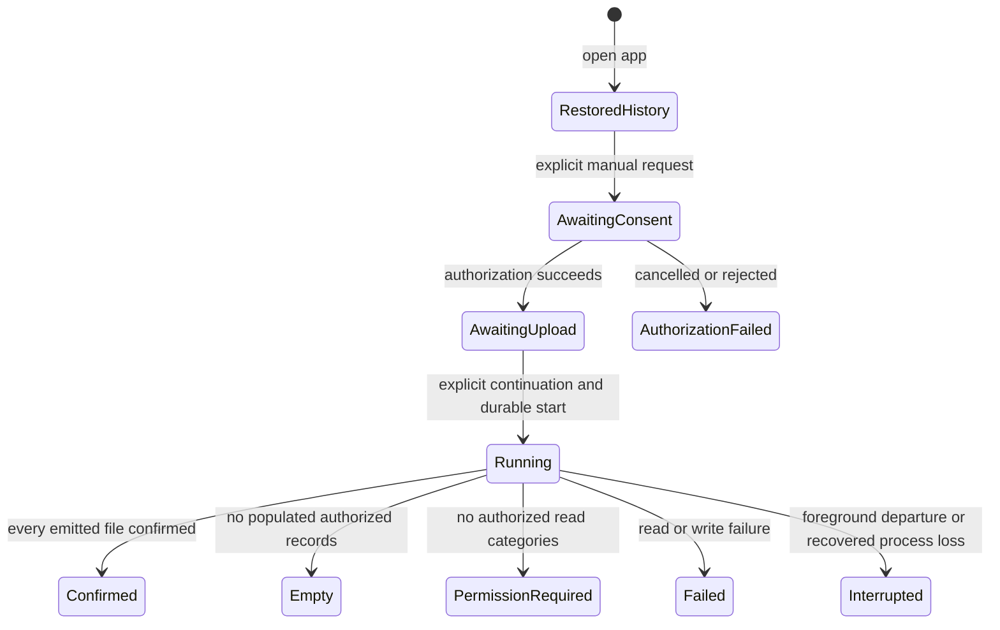

# V1 foundation — durable manual sync history

## 1. 한눈에 보기

- Problem: P0 loses attempt/success information on process death, so users cannot distinguish a previous confirmed upload from an interrupted attempt after reopening the app.
- Result: keep minimal app-private manual-sync history across process recreation while retaining fresh authorization, explicit upload continuation and foreground-only execution.
- Completion: persisted outcome and recovery behavior satisfy section 5 using synthetic automated tests and explicitly recorded Galaxy validation, without asserting current-account coverage from historical local metadata.

## 2. 범위

### 포함

- First V1 implementation slice: durable latest attempt and latest confirmed success, with reporting date, timing, authorized-category coverage, confirmed-file count and allowlisted outcome/failure category.
- Distinguish authorization attempt from actual execution start and completion; restore history as historical information on app open.
- Recover interrupted local execution metadata after process death and handle unavailable/corrupt local state explicitly.
- Preserve the existing manual yesterday-in-Asia/Seoul export and explicit local forget action; explain its local-only effect.
- Keep earlier success when a later attempt fails, is empty, loses permission or is interrupted; show limited authorized coverage without calling it a complete five-category day.
- Restructure the existing Compose screen into a status-first home with expandable details/settings; define explicit local-history deletion and recovery states.

This is preparatory specification work. Implementation entry requires explicit P0 gate disposition and approval of this specification and its later execution plan. It does not declare P0 complete. The first slice is not completion of the full [V1 roadmap](../implementation-plan.md).

### 제외

- WorkManager, automatic reads/uploads on app open, background permission changes, missed-date backfill and date-range selection.
- SAF or both-destination implementation, arbitrary destination selection, per-file revision retry and account-bound durable destination coverage.
- Persistent OAuth tokens, persistent upload consent, account identifiers, raw measurements, exported CSV bodies or extra health-data staging.
- Changes to CSV schema, source aggregation, interval lookup, Drive scope/privacy checks, signing identity or implicit network retry.
- Performance instrumentation/optimization, incremental Changes API, backend, MCP and workout plans.

## 3. 확인한 사실과 가정

| Kind | Content | Evidence or confirmation |
| --- | --- | --- |
| Verified | Baseline is merged PR #6, `b9c4eb4`; application files remain identical to validated reader source `d33edae`. | Git diff and [current security disposition](../P0/current-security-disposition.md). |
| Verified | `SyncUiState` and token live only in ViewModel memory; `lastAttempt` currently starts before Google authorization completes. | `android/app/src/main/java/com/ny/my/health/SyncViewModel.kt`. |
| Verified | The coordinator exposes date-based execution and confirmed-file count, returning SUCCESS, EMPTY, PERMISSION_REQUIRED or FAILED; cancellation propagates. | `android/core/src/main/kotlin/com/ny/my/health/core/SyncCoordinator.kt` and `Model.kt`. |
| Verified | App-private backup and cleartext are disabled; no existing durable sync-history store or automatic scheduler is present. | App manifest and app/core sources. |
| Proposed design | One Material 3 home screen, expandable details/settings, and deletion only when no authorization/execution/history operation is active. | Proposed in this draft; visual approval remains pending. |
| Verified | The existing screen uses Material 3, a scrolling Column, text, buttons and a checkbox; detailed status and local forget share that screen. | `android/app/src/main/java/com/ny/my/health/MainActivity.kt`, inspected during this review. |
| Proposed scope | Durable manual history is the first slice of V1; scheduling, backfill and SAF follow separately. | Existing roadmap requires durable status; owner approval of this draft confirms slice order. |
| Risk | History cannot establish which Google account currently owns a remote export or whether every source record existed. | Do not persist account identities in this slice or use history to skip writes; UI must state its limited historical meaning. |
| Breaking condition | Adding automatic execution, durable consent/tokens, account-bound coverage or another destination invalidates this slice's consent/identity assumptions. | Requires a separate approved specification before implementation. |
| Verified | Prerequisite environment: JUnit 4/core coroutine tests, app local-TLS JVM tests, Compose instrumentation tests and SDK 36/JDK 21 tooling exist. | Existing test sources, Gradle files, `/workspace/tooling/run-health-command.py`. |
| Risk | Prerequisite environment: physical Galaxy/control is absent here; local emulator executable is absent, but an emulator CI workflow exists. | `/workspace/tooling/android-sdk/platform-tools/adb` exists; `.github/workflows/android-emulator-tests.yml`; device results remain owner-operated. |
| Risk | Prerequisite environment: durable Android store and restart/failure tests for it are absent, introduction required. | No store dependency/implementation in app; select the smallest suitable mechanism during the approved plan, without assuming Room/DataStore exists. |

## 4. 외부 계약과 흐름

External contract changes: none. [CSV v0.1](../data-contract.md), Health Connect read permissions, `drive.file`, existing private-target rules and explicit Google authorization remain unchanged. This slice defines local metadata behavior only and does not introduce a server API.

### 내부 흐름

Asynchronous execution and durable state introduce a recovery boundary. The diagram describes outcomes, not a new public API or a mandated storage technology.

Restoration performs no health read or remote write. Only an actually started execution can become an interrupted execution; an unfinished authorization request cannot be reported as a started upload. Durable history and consent are separate: restoring history never restores upload permission. A previous success is retained independently of the latest attempt outcome.

### 화면 디자인 초안

This is a proposed layout and copy contract, not an implemented screen or approved visual mockup. Reuse Compose Material 3 components; no new chart, navigation framework or design dependency is required by this specification.

| 위에서 아래 순서 | 내용과 예시 |
| --- | --- |
| 앱 제목과 대상 날짜 | Health App · 수동 동기화 / 이번 동기화 대상: 어제, YYYY-MM-DD (한국 시간) |
| 현재 상태 카드 | 가장 최근 시도 또는 현재 오류를 우선 표시. 예: “업로드 중단 · 일부 파일이 저장됐을 수 있습니다.” |
| 마지막 성공 카드 | “마지막 업로드 확인” / 대상 날짜, 확인 시각, 당시 허용 항목, 확인된 파일 수. “이 기기의 과거 기록이며 현재 계정·원본 전체의 완료 여부는 확인되지 않았습니다.” |
| 동기화 영역 | 필요한 권한 안내 → 비공개 Drive 업로드 동의 → “Google 권한 확인” → 인증 후 별도 “업로드 계속”. 실행 중에는 진행 상태와 “화면을 벗어나면 중단됩니다” 표시. |
| 상세·설정 펼치기 | 인증 요청/실행 시작/종료 시각, 허용 항목 이름, 안전한 오류 분류, 권한 다시 확인, 로컬 이력 삭제. 전체 이력 목록은 제공하지 않음. |

Use a neutral surface and one primary action color; reserve error styling for actionable failures. Status must also be conveyed by text, not color alone. Keep the latest failure visible even when an earlier success exists. Historical success must not be titled “최신 동기화 완료” or imply today's data is complete.

Example state copy:
- No history: “저장된 동기화 이력이 없습니다.”
- Authorization abandoned: “인증 단계에서 종료됨 · 업로드 미시작”
- Authorized but not started: “업로드 시작 전 종료됨 · 다시 인증해 주세요.”
- Running outcome unknown: “실행 중 종료됨 · 업로드 결과를 확인할 수 없습니다.”
- Remote success but local result save failed: “업로드는 확인됐지만 이력 저장에 실패했습니다.” This is transient evidence only; it must not replace the last durably confirmed success.
- Corrupt/unsupported/unreadable history: “이력을 읽을 수 없습니다. 다시 불러오거나 로컬 이력을 삭제해 주세요.”

### 삭제와 복구 흐름

“로컬 이력 삭제” opens a confirmation dialog explaining: “이 기기의 동기화 이력과 현재 업로드 동의를 지웁니다. Drive 파일과 Health Connect·Google 권한은 유지됩니다.” Actions are “취소” and “이력 삭제”.

On confirmation, invalidate in-memory consent, token and prepared continuation immediately, then attempt atomic durable clearing. During deletion, disable new authorization, execution and duplicate deletion. Announce completion only after the store acknowledges a durable empty state. The UI must distinguish a failed deletion from successful deletion.

Recovery reads local history only. “다시 불러오기” retries local storage access; it does not retry uploads. A new upload always follows the explicit manual consent/authorization/continuation flow.

## 5. 성공 기준

### Durable history

- After confirmed manual upload and process recreation, the UI restores its reporting date, confirmation time, granted-category coverage and confirmed-file count as historical local success.
- The history stores only the latest attempt and latest confirmed success, with a format version and bounded metadata, and contains no token, account/file/record identifier, raw measurement, CSV body or provider error text.
- An attempt records authorization-request time separately from actual execution-start time, so cancelling authorization does not create a fictitious started upload.
- A failed local start-state write prevents health reading and remote upload, and an uncommitted result is never presented as a durably recorded success.
- Failure or interruption while persisting a result preserves the previous committed record and reports an explicit local-history failure without asserting that already-issued remote writes were rolled back.

### Recovery and consent

- A persisted started execution without a committed terminal outcome is shown as interrupted or indeterminate after process recreation, with no automatic retry and no fabricated success.
- After process recreation, upload consent is unchecked, no token or prepared continuation is restored, and no health read or network write occurs until fresh manual consent/authorization/continuation.
- A later failed, empty, permission-required or interrupted attempt updates latest-attempt status while retaining the previous independently confirmed success.
- Duplicate UI actions cannot run overlapping manual executions or let a stale completion overwrite a newer local forget operation.
- Missing history starts as no local history, while unsupported or corrupt stored history produces a recoverable explicit state and never fabricated zero measurements or success.

### UI meaning and privacy

- The UI distinguishes authorization time, actual execution start, latest outcome and previous confirmed reporting date, and indicates partial authorized scope rather than complete five-category coverage.
- Restored history is labelled as local historical evidence whose current Google-account association and upstream completeness are unverified, and is never used to skip a fresh read/upload or advance a backfill cursor.
- A confirmed successful local forget clears persisted history and in-memory consent/token/status without deleting Drive files or claiming to revoke Health Connect or Google grants; failure and interruption follow the deletion criteria below.
- The same reporting-day paths, CSV payload rules, explicit EMPTY semantics, granted-type filtering and private Drive target checks remain unchanged under the existing meaningful regressions.

### 화면 구성과 접근성

- The collapsed home shows the target reporting date, current attempt/error state, independently retained last confirmed success and the next permitted action without opening details.
- Last-success date, timestamp, coverage and file count all come from the same committed success record; a later failed attempt's count is never displayed as that success's count.
- Expanded details distinguish authorization-request time, actual execution-start time and terminal time, displaying absent times as “미시작” or “확인 불가” as appropriate rather than inventing timestamps.
- A failed or interrupted latest attempt remains visible alongside an earlier success; EMPTY is shown as no records to export, not successful upload.
- Authorization and explicit upload continuation remain separate actions, with no automatic read/upload caused by expanding details, restoring the screen or loading history.
- The screen remains readable and operable with system light/dark themes, enlarged system text and TalkBack; critical state, confirmation controls and next actions must not be clipped, overlap or rely on color alone.
- Synthetic UI previews or screenshots cover no history, committed success, authorization pending, running, interrupted, history-read failure and deletion failure; these are review artifacts, not evidence of real account/device success.

### 로컬 이력 삭제와 실패

- Cancelling the deletion dialog changes neither durable history nor current consent/token state.
- Deletion is unavailable while permission/authorization is pending, a sync is running, or a history read/write/delete is in progress; the reason is visible and the operation is rejected even if a stale UI event arrives.
- Confirming deletion immediately clears in-memory consent, token and prepared continuation before durable deletion is attempted.
- A durable empty-state commit clears both latest attempt and latest success together; a fresh store reopen after acknowledged completion finds no local history.
- If deletion fails, show “이력 삭제에 실패했습니다. 저장된 이력이 남아 있을 수 있습니다.” and provide “삭제 다시 시도”; do not show “삭제 완료” or restore consent/token.
- After deletion failure, any retained readable record is marked “삭제되지 않은 기존 이력”; unreadable storage remains explicitly unknown rather than appearing empty.
- After deletion failure, new authorization/upload stays disabled for the current session until deletion succeeds or the user explicitly chooses “삭제 취소·기존 이력 유지” and the store is successfully reloaded; neither action restores consent/token.
- If the process ends during deletion, reopening shows the actual committed state: empty after committed clearing, otherwise the retained prior history or an explicit read error; it never claims an interrupted deletion completed.
- An uncommitted deletion intention need not survive process loss; persisted history may reappear after an interrupted/failed deletion, but a durably acknowledged deletion must not be undone by stale callbacks, result writes or recovery.
- Deletion is idempotent: deleting already-empty history succeeds without remote calls, and any deletion failure remains a storage error rather than a fake success.
- Local deletion does not delete Drive exports, revoke external grants, clear Health Connect records or promise forensic secure erasure.

### 재시작과 저장소 복구

- A persisted pending authorization without execution start restores as “인증 단계에서 종료됨 · 업로드 미시작”; persisted authorization success awaiting continuation restores as “업로드 시작 전 종료됨 · 다시 인증해 주세요.”
- A persisted running attempt without a committed terminal result restores as interrupted/indeterminate, without fabricated completion time or guaranteed uploaded-file count; remote files may already exist.
- A committed terminal result restores its actual outcome, while failed/empty/interrupted attempts retain the independently committed previous success.
- Unsupported-format, corrupt and unavailable history are distinguished from an absent history store; no automatic reset or overwrite occurs merely because reading failed.
- While history is unreadable or unsupported, new authorization/upload is blocked until an explicit reload succeeds or a user-confirmed local reset durably succeeds; reset failure follows the deletion-failure rules.
- Persisting a recovered status uses the same atomic failure rules as ordinary results; if recovery persistence fails, show the derived interruption together with a local-history error and do not claim durable recovery.
- App reopen never restores tokens, upload consent or a prepared continuation, even after failed deletion or abandoned authorization.

## 6. 제약과 경계

- Preserve the foreground-only cancellation boundary until a separately approved background execution change; WorkManager behavior is outside this slice.
- State writes must provide a documented atomic commit/recovery boundary and a versioned read policy; do not select a new database framework without showing why existing platform capabilities are insufficient.
- Pure state transitions, ordering and serialization need SDK-free JVM tests; actual persistence/reopen and failure recovery need real store tests rather than mock call-count assertions alone, plus suitable Android instrumentation for lifecycle integration.
- Run existing core/app regressions, APK build and lint after implementation; use synthetic fixtures only. Record Galaxy process-death/reopen/manual-recovery checks separately from emulator and JVM evidence.
- New app-private metadata is sensitive. Keep it out of public Git/logs, preserve backup exclusion, and introduce no new external service, permission or persistent credential.
- Except for explicitly confirmed successful local deletion, no local history loss may silently erase an earlier persisted success, and no history success can imply remote transactionality, account identity, every source category or current freshness.
- Validate delete failure, process loss before/after empty-state commit, stale completion, corrupt/unsupported formats and recovery-write failure with synthetic fixtures and actual store reopen tests. Mocked method-call assertions alone do not establish durability. UI evidence must use synthetic dates/counts and exclude personal data.
- Required owner decisions: approval of this bounded slice and disposition of pending P0 gates before implementation; review any later scope, schema or dependency additions through the applicable workflow.

## 7. 미해결 사항

- P0 source-session bound comparison, separate recoverable signing-key backup, D03/D04 isolated revocation setup/disposition and D09 dialog-cancellation observation retain their actual statuses in [device acceptance](../P0/device-acceptance.md); automatic PR review does not close them.
- Proposed screen arrangement, wording, idle-only deletion and failure-recovery policy require owner review; exact spacing/color tokens and synthetic visual samples are implementation deliverables, not completed designs.
- Owner approval of this first-slice scope is pending. The specification remains `draft`; automated code-review success or merging documentation is not specification approval.
- Persistence technology and detailed task breakdown are intentionally undecided until specification approval; neither a plan nor implementation tasks are included here.
- WorkManager/background authorization, account-bound per-day coverage, bounded backfill and SAF capability/privacy decisions remain separate V1 follow-up work under [storage design](storage-destinations.md) and the roadmap.
